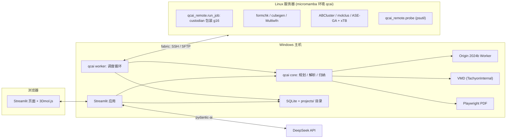
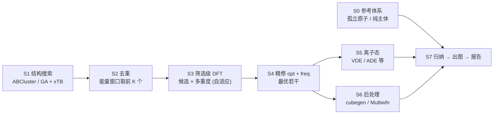

# QuantumChem AI 开发方案 v2.0（复用优先 · 单 AI 执行版）

> 本文件是 QuantumChem AI 的**唯一执行依据**，取代 v1.5 方案及 OpenBot 多代理任务卡。
> v2.0 的核心变化：**凡是成熟开源库 / 现成程序能做的，一律调用；只自研团簇领域逻辑和各组件之间的衔接代码。**

---

## 0. 给执行 AI 的说明（必读）

### 0.1 你的任务

按第 9 节的阶段顺序（P0 → P8），在 `C:\dev\quantumchem-ai` 中独立实现本系统。每个阶段都有交付物、验收标准和人类检查点。

### 0.2 执行规则

1. **开始前通读全文**。实现细节可以自行决定，但不得违反第 2.2 节的设计公理和第 3 节的复用约定。
2. **先验证再依赖**：第 3 节中标记为 🔍 的库能力，必须在 P0 阶段用最小脚本验证；验证失败时按表中的“备选”执行，并在 `docs/decisions.md` 记录。
3. **偏离方案必须记录**：任何偏离写入 `docs/decisions.md`（日期 / 决策 / 理由）。
4. **每个阶段结束**：
   - 运行 `uv run ruff check . ; uv run ruff format --check . ; uv run mypy src ; uv run pytest`，全部通过；
   - 满足该阶段的验收标准；
   - 更新 `docs/progress.md`（完成了什么、如何验证、遗留问题），然后 git commit（一个阶段至少一次提交，提交信息使用 Conventional Commits）。
5. **遇到人类检查点（🧑 标记）就停下**：在 `docs/progress.md` 的“待人类处理”区写清楚需要什么，然后继续做不受阻塞的工作；没有可做的工作时，停下并向人类报告。
6. **Windows + PowerShell 环境**：每个会话在运行外部命令前先执行
   ```powershell
   $OutputEncoding = [Console]::OutputEncoding = [System.Text.UTF8Encoding]::new($false)
   $env:PYTHONUTF8 = '1'
   ```
   所有文件使用 UTF-8 编码；路径一律用 `pathlib`。

### 0.3 绝对禁止

- 把凭据（SSH 密钥/密码、DeepSeek API Key）写进代码、git、日志或 LLM 上下文。凭据只存放在 `config/settings.toml`（已加入 .gitignore）或系统密钥环（`keyring`）中。
- 在人类确认前向服务器提交真实计算作业（P3 有明确的确认点）。
- 远程执行白名单以外的命令；读写服务器工作根目录以外的路径；对工作根目录以外的路径执行 `rm`。
- 在代码中为特定元素或体系写特例分支（例如 `if element == "Au"`）。
- 让 LLM 生成任何数值结果。

---

## 1. 项目目标与已确认决策

**一句话目标**：用户只需选择“体系 + 研究目标 + 精度”，系统自动完成 结构搜索 → Gaussian 计算 → 结果解析 → Multiwfn 分析 → 出图 → PDF 报告 → AI 解读。

**v1 的三项基础功能**（必须最先可用）：Gaussian 输入文件生成、计算结果解析、轨道能级与自旋数据可视化。

| 项目 | 决策（已与用户确认） |
|------|----------------------|
| 研究对象 | 团簇：纯团簇 / 掺杂 / 双金属合金，**元素不限**；通过 `ClusterProfile` 接口预留其他体系 |
| 使用方式 | 随选即得：任意选择体系与研究目标，系统自动决定计算方案并输出结果 |
| 前端 | Web（本机浏览器访问） |
| LLM | DeepSeek API |
| 计算资源 | 通过 SSH 连接 Linux 服务器，**直接运行 g16**（无作业调度系统），服务器已装 Multiwfn，可安装 xTB |
| 资源配置 | 不预设服务器规模，自适应探测与调整 |
| 2D 出图 | Origin 2024b（Windows 主机，`originpro`），无 Origin 时降级为 Matplotlib |
| 3D 出图 | Web 实时交互预览（3Dmol.js）+ Windows 主机 VMD 出版级渲染 |
| 报告 | PDF（主交付物），同时生成 HTML 版 |

---

## 2. 第一性原理与设计公理

### 2.1 问题拆解

$$
\underbrace{\text{体系}}_{\text{元素 + 尺寸}} + \underbrace{\text{目标}}_{\text{要什么性质}} + \underbrace{\text{预算}}_{\text{精度 / 时间}} \;\Longrightarrow\; \text{结果}
$$

用户提供的信息与 Gaussian 实际需要的信息之间存在差距：初始结构、电荷、多重度、泛函、基组、ECP、关键词、资源、失败处理、分析与出图。**本系统的价值就是自动填补这个差距**。逐项看，大部分差距都已有成熟工具可以填补，真正需要自研的只是“团簇领域决策”和“流程衔接”：

| 差距 | 填补者 |
|------|--------|
| 初始结构 | ABCluster / ASE 遗传算法 + xTB（复用） |
| 理论水平、多重度、电荷态 | **规则引擎（自研，YAML 规则 + 元素属性）** |
| 输入文件 | pymatgen `GaussianInput`（复用） |
| 运行与失败修复 | custodian 的 Gaussian 错误处理器（复用）+ 少量自研处理器 |
| 解析 | cclib（复用）+ 少量正则补充 |
| 波函数分析 | Multiwfn、cubegen（复用） |
| 团簇物理量与结论 | **归纳层（自研）** |
| 出图与报告 | Origin / VMD / 3Dmol.js / Playwright（复用）+ 模板 |
| 自然语言与解读 | DeepSeek + pydantic-ai（复用）+ **数值校验（自研）** |

### 2.2 设计公理（不可违反）

| # | 公理 | 落地方式 |
|---|------|----------|
| A1 | **数值确定性** | 所有能量、轨道、自旋数值只来自计算程序输出的解析；LLM 只解释，永不生成数字 |
| A2 | **通用性来自规则** | 元素差异全部通过元素属性（pymatgen `Element`）+ YAML 规则表达，代码中没有元素特例 |
| A3 | **默认值可见、可覆盖** | 每个自动决策都生成 `Decision(key, value, reason, source_rule)`，用户可逐项覆盖 |
| A4 | **对比量同理论水平** | 参考体系（孤立原子、纯主体、离子态）自动补齐，并由代码强制检查理论水平一致 |
| A5 | **复用优先** | 自研前先查第 3 节；新增依赖须写入 `docs/decisions.md` |
| A6 | **扩展靠接口** | 体系类型、结构搜索器、渲染器、作业执行器、量化程序、LLM 都通过抽象基类 + 注册表接入 |
| A7 | **core 纯净** | `core/`、`planner/`、`analysis/` 不做网络、SSH、子进程或 LLM 调用，便于测试 |
| A8 | **长任务放在服务器端** | 失败修复和后处理在服务器上的作业包装脚本内完成，Windows 主机断网或休眠不影响计算 |

---

## 3. 复用地图（v2.0 的核心）

### 3.1 功能 → 复用组件 → 自研部分

🔍 = P0 必须用最小脚本验证的能力。

| 功能 | 复用组件 | 自研部分（保持很薄） | 🔍 验证点 / 备选 |
|------|----------|----------------------|------------------|
| 元素数据 | **pymatgen `Element`**（周期、族、区、价电子、过渡金属/镧系判断）；**ASE `ase.data`**（共价半径、`ground_state_magnetic_moments` → 原子基态多重度） | 无，只在规则中引用这些属性 | 抽查 Fe=5、Co=4、Ni=3、Cu=2、Au=2、Pt=3 的基态多重度 |
| 单位换算 | `ase.units` 或 `scipy.constants` | 无 | — |
| 结构读写 | **ASE `ase.io`**（xyz、多帧 xyz、POSCAR、gjf 等） | ABCluster / molclus 输出格式的小型读取器 | — |
| 点群与等价原子 | **pymatgen `PointGroupAnalyzer`**（`get_pointgroup`、`get_equivalent_atoms`、对称操作） | 多原子掺杂时，利用对称操作对位点组合做轨道去重 | 🔍 对团簇设置合适的容差 |
| 结构去重 | **pymatgen `molecule_matcher`**（`HungarianOrderMatcher` / `BruteForceOrderMatcher`，与原子顺序无关的 RMSD） | 距离矩阵特征值指纹预筛（numpy，几行代码） | 🔍 速度；太慢时只用指纹 |
| 全局结构搜索 | **ABCluster**（`geom` 模块内置 xTB；或 `isomer` 模块 + `runxTB.sh`）为主；**molclus** 备选 | 生成输入、调用、回收结果的适配器 | 🔍 ABCluster 版本与输入格式以官方手册为准 |
| 搜索兜底 | **ASE 遗传算法 `ase.ga`**（支持团簇与多组分同位异构）+ **tblite-python**（GFN-xTB 的 ASE 计算器），在服务器端运行 | 薄封装脚本 | 🔍 tblite 在服务器环境可用 |
| xTB | **xtb**（conda-forge 安装） | 无 | — |
| 基组覆盖与 genecp | Gaussian **内置 def2 系列**（Z>36 自动使用 ECP，覆盖 H–Rn）；**basis_set_exchange**（元素覆盖查询，必要时生成 Gaussian94 格式基组/ECP 块） | 覆盖检查规则 | 🔍 BSE 生成的 genecp 块能被 g16 读取 |
| Gaussian 输入 | **pymatgen `GaussianInput`**（与 custodian 兼容） | 由 `CalcSpec` 转换为 GaussianInput 的转换函数 | 🔍 `nosymm`、`stable=opt`、`gen_basis`、Link0 均可表达 |
| 运行时失败修复 | **custodian**：`custodian.gaussian.jobs.GaussianJob` + `custodian.gaussian.handlers.GaussianErrorHandler`（SCF 不收敛、优化步数耗尽、内存等） | 自研 custodian 处理器补齐缺口：虚频扰动重优化、波函数不稳定、多重度初猜 | 🔍 GaussianErrorHandler 覆盖哪些错误；不可用时自研同接口的处理器 |
| 输出解析 | **cclib**（能量、轨道能级、HOMO 索引、Mulliken 电荷与自旋、频率、几何轨迹、热力学量）；**pymatgen `GaussianOutput`** 作交叉核对 | 正则补充：`<S²>`（湮灭前/后）、波函数稳定性、终止状态与 Lnnnn 错误码、Link1 分段 | 🔍 cclib 的 `atomspins` 对 Gaussian 开壳层输出可用 |
| 格点数据（cube） | **Gaussian `cubegen`**（`MO=HOMO/LUMO`、`Spin=SCF`），不依赖 Multiwfn 菜单，跨版本稳定 | 命令模板 | — |
| 电荷/自旋布居、PDOS、轨道成分 | **Multiwfn**（stdin 批处理）；Gaussian `pop=hirshfeld` 作为 Hirshfeld/CM5 的备选来源 | 3 个指令模板（绑定 Multiwfn 版本）+ 输出解析器 | 🔍 服务器上 Multiwfn 的版本与菜单编号 |
| TDOS | numpy 对轨道能级做高斯展宽 | 约 20 行代码 | — |
| 作业脚本与状态 | **qtoolkit**（`ShellIO` 生成直接运行脚本，并解析提交/状态信息；以后可换 Slurm/PBS） | 本地作业表 + 调度循环 | 🔍 qtoolkit ShellIO 接口；不合适时自研约 100 行的 DirectRunner |
| SSH / SFTP | **fabric**（基于 paramiko） | 白名单命令封装 | — |
| 服务器资源探测 | 服务器端 **psutil** + `lscpu -J`（NUMA） | 约 50 行 `probe.py` | — |
| 服务器端环境 | **micromamba**（无需 root）+ conda-forge | 安装脚本 | 🧑 需要人类授权在服务器安装 |
| 持久化 | **SQLModel**（SQLite） | 表结构 | — |
| CLI 与配置 | **Typer**、**pydantic-settings**（TOML）、**keyring** | — | — |
| 2D 出版图 | **Origin 2024b + `originpro`**（官方 Python 包）+ `.otpu` 图形模板 | Origin Worker（独立进程、串行执行、超时重启） | 🔍 originpro 后台驱动 Origin 2024b |
| 2D 降级 | **Matplotlib** | 与 Origin 共用同一份 `FigureSpec` | — |
| 3D 预览 | **py3Dmol**（3Dmol.js），在 Streamlit 中用 `components.html` 嵌入 | 页面组件 | — |
| 3D 出版图 | **VMD**（Windows）+ 内置 **TachyonInternal** 渲染器 | Tcl 脚本模板 | 🔍 Windows 版 VMD 能否无界面批处理；不能时最小化窗口运行并在脚本末尾 `quit` |
| PDF 报告 | **Jinja2** → HTML → **Playwright**（无头 Chromium）打印 PDF | 报告模板、方法学段落规则、参考文献表 | 🔍 中文字体与 SVG 嵌入 |
| Web | **Streamlit**（多页面）+ 后台 `qcai worker` 进程，两者通过 SQLite 通信 | 页面 | — |
| LLM | **pydantic-ai**（`DeepSeekProvider`、工具调用、结构化输出、`output_validator` + `ModelRetry`） | 工具函数薄封装 + 数值校验器 | 🔍 DeepSeek 工具调用与当前模型名 |

### 3.2 明确不做（避免重复造轮子）

| 不做 | 原因 / 替代 |
|------|-------------|
| 自建元素知识表 `elements.json` | pymatgen `Element` + ASE 数据已覆盖 |
| 自写 Gaussian 日志全量解析器 | cclib + 少量正则 |
| 自写通用 DAG 工作流引擎 | 团簇流程是固定的漏斗阶段，用“阶段函数 + SQLite 作业表 + 调度循环”实现（第 6.5 节） |
| 自写失败重试框架 | custodian |
| 自写多面体模板库与盆地跳跃搜索 | ABCluster 为主，ASE 遗传算法兜底 |
| 自写图同构等价位点算法 | pymatgen `PointGroupAnalyzer.get_equivalent_atoms` |
| 用 Multiwfn 生成 cube | Gaussian 自带的 `cubegen` 更稳定 |
| v1 引入 FastAPI | 单用户本机工具，Streamlit 直接调用 core 即可；以后需要其他客户端时再加 |
| 自写 LLM 工具调用循环 | pydantic-ai |
| 3D 视角双向同步（v1） | v1 网页预览与 VMD 都使用按惯量主轴计算的同一默认视角；双向同步放到 v2 |
| AiiDA / jobflow-remote 等重型框架 | 依赖 MongoDB 或数据库服务，对单台服务器直接运行 g16 而言过重 |

### 3.3 与 v1.5 相比的结构性变化

| 方面 | v1.5 | v2.0 |
|------|------|------|
| 失败修复 | Windows 主机上的自研自愈机制 | **服务器端 custodian**（加少量自研处理器），断线不影响 |
| 后处理 | 主机逐步远程调用 formchk、Multiwfn | 服务器端作业包装脚本一次完成：g16 → formchk → cubegen → Multiwfn |
| 编排 | 通用动态 DAG 引擎 | 固定漏斗阶段 + 作业表 |
| 元素知识 | 自建 JSON | pymatgen + ASE |
| 结构生成 | 模板库 + 盆地跳跃 + 外部程序 | ABCluster / molclus + ASE 遗传算法兜底 |
| 资源探测 | 纯 shell 脚本 | 服务器端 psutil |
| Web | FastAPI + Streamlit | 仅 Streamlit + 后台 worker |
| 实施顺序 | 按模块 | **先交付离线可用的 v1 三项基础功能，再逐步自动化** |

---

## 4. 系统架构



**两个代码包**
- `qcai`（Windows 主机）：完整应用。
- `qcai_remote`（服务器端，纯 Python，依赖只有 custodian、pymatgen、cclib、ase、psutil、tblite）：由主机通过 SFTP 部署到服务器工作根目录，提供 `probe`、`run_job`、`search` 三个入口。它与 `qcai` 位于同一仓库（`src/qcai_remote/`），通过 JSON 文件与主机交换数据。

**服务器端作业目录约定**：`<work_root>/<project_id>/<job_id>/`，包含 `job.json`（作业描述）、`job.gjf`、`job.log`、`job.fchk`、`*.cube`、`mwfn_*.txt`、`status.json`（状态：`running` / `done` / `failed`，以及 custodian 修复记录）。主机只需轮询 `status.json`。

---

## 5. 领域规则（本项目自研的核心知识）

规则写在 `src/qcai/knowledge/rules/*.yaml` 中，每条规则包含 `id`、`when`（条件，只能引用元素属性和体系属性）、`then`（动作）、`reason`（中文理由）、`refs`（文献）。

### 5.1 电子态

- 电子数 `N = Σ Z_i − q`；多重度 `M = 2S+1`；**N 偶 ⇔ M 奇**，且 `M − 1 ≤ N`。（Gaussian 使用 ECP 时输出的是价电子数，校验时需区分。）
- 开壳层（M > 1）方法自动加 `U` 前缀。
- 自旋污染：理想值 `<S²> = S(S+1)`，偏差超过 10% 时标记。
- 总磁矩 `μ = 2S μ_B`；原子局域磁矩 ≈ 原子自旋布居。

### 5.2 多重度自适应扫描

1. 由 N 的奇偶性确定序列 1, 3, 5… 或 2, 4, 6…
2. 上限 `M_max = min(Σ 原子未成对电子数 + 1, 用户上限)`，至少扫描 2 个态；原子未成对电子数取自 `ase.data.ground_state_magnetic_moments`。
3. 从低到高逐个计算；若能量相对当前最低值**连续两个态都高出阈值**（默认 0.5 eV），停止扫描更高的态。
4. 若最低能态位于扫描边界，自动向外扩展。

### 5.3 理论水平（三档精度）

默认使用 **def2 系列**：覆盖 H–Rn，Gaussian 对 Z > 36 自动使用对应 ECP，因此任意元素组合都不需要手写 genecp。

| 档位 | 结构搜索 | 筛选级 DFT | 精修级 DFT |
|------|----------|------------|------------|
| 快速 | GFN-xTB | PBE-D3BJ/def2-SVP | — |
| 标准（默认） | GFN-xTB | PBE-D3BJ/def2-SVP | PBE0-D3BJ/def2-TZVP，opt + freq |
| 高精度 | GFN-xTB | PBE0-D3BJ/def2-SVP | PBE0 或 TPSSh-D3BJ/def2-TZVP，opt + freq + 稳定性检查 |

按元素类别自动调整（只依赖元素属性）：

| 条件 | 动作 |
|------|------|
| 含 d 区过渡金属 | 扩大多重度上限；开启 `stable=opt`；SCF 策略设为 robust（`scf=(xqc,maxcycle=500)`） |
| 所有团簇 | 默认 `nosymm` |
| 含 f 区元素 | 标记为实验性支持并给出警告，仍允许运行 |
| 用户指定的基组不覆盖某元素 | 阻断，并列出可用替代（由 basis_set_exchange 查询） |
| 体系超过规模阈值 | 精修级降为 def2-SVP 或减少候选数，并在方案书中说明 |

### 5.4 电荷态由研究目标推导

| 研究目标 | 自动加入的电荷态与作业 |
|----------|------------------------|
| 结构与稳定性 / 电子结构 / 磁性 | 中性（或用户指定） |
| 光电子能谱对比 | 阴离子优化 + 阴离子构型下的中性单点（VDE）+ 中性优化（ADE） |
| 电离能 / 电子亲和能 | 阳离子、中性、阴离子 |

### 5.5 研究目标模板（Recipe）

| 模板 | 产出 |
|------|------|
| 结构与稳定性 | 基态结构、异构体排序、Eb、Δ₂E、碎裂能、掺杂能量学 |
| 电子结构 | 轨道能级、HOMO–LUMO 能隙、TDOS/PDOS、前线轨道成分、价电子计数 |
| 磁性与自旋 | 自旋态能量阶梯、总磁矩、原子自旋布居、自旋局域度、自旋密度 3D 图、`<S²>` |
| 光电子能谱对比 | VDE、ADE，可输入实验值对比 |
| 尺寸演化 | 对 n = a…b 执行所选模板，输出性质随 n 变化的曲线 |
| 自定义 | 用户自由组合分析项 |

多个模板合并时，共享的作业只计算一次。

### 5.6 归纳物理量（`analysis/`，纯函数，均需手算对照测试）

| 物理量 | 公式 | 适用条件 |
|--------|------|----------|
| 平均结合能 | $E_b = \dfrac{\sum_i n_i E(\text{X}_i) - E(\text{cluster})}{\sum_i n_i}$ | 全部 |
| 二阶能量差分 | $\Delta_2 E(n) = E(n+1) + E(n-1) - 2E(n)$ | 尺寸演化 |
| 碎裂能 | $E_f = E(n-1) + E(1) - E(n)$ | 尺寸演化 |
| 嵌入能 | $E_\text{emb} = E(\text{H}_n) + E(\text{D}) - E(\text{DH}_n)$ | 主体 + 少量掺杂 |
| 取代能 | $E_\text{sub} = E(\text{DH}_{n-1}) + E(\text{H}) - E(\text{H}_n) - E(\text{D})$ | 主体 + 少量掺杂 |
| 混合能 | $\Delta = E(\text{A}_m\text{B}_n) - \tfrac{m}{N}E(\text{A}_N) - \tfrac{n}{N}E(\text{B}_N)$ | 双金属 |
| HOMO–LUMO 能隙 | 开壳层取 α、β 中较小者 | 全部 |
| 电荷转移 | 掺杂原子的 Hirshfeld / ADCH 电荷 | 多元素 |
| 自旋局域度 | $f_\text{D} = \rho^s_\text{D} / \sum_i \rho^s_i$ | 开壳层多元素 |
| 价电子计数 | 是否满足 2, 8, 18, 20, 34, 40, 58（凝胶模型闭壳层） | 全部 |
| VDE / ADE / VIP / VEA | 对应电荷态能量差 | 选择了对应模板 |

孤立原子参考能量必须使用该原子的基态多重度，并与目标体系采用同一理论水平（公理 A4）。

---

## 6. 模块设计

### 6.1 结构与搜索（`structure/`、`qcai_remote/search.py`）

- **`StructureGenerator` 接口**，实现按优先级排列：`ImportGenerator`（用户上传）> `ABClusterGenerator` > `MolclusGenerator` > `AseGaGenerator`（兜底）。按 `qcai doctor` 的探测结果自动选择可用的生成器。
- 生成器运行在服务器上（通过作业系统提交，与 Gaussian 作业共享并发控制），主机只负责生成输入和解析结果。
- **掺杂枚举**（`dopant_sites.py`，自研的差异化功能）：
  - 单掺杂：`PointGroupAnalyzer.get_equivalent_atoms()` 直接给出不等价位点；
  - 多掺杂与双金属：枚举位点组合，用点群对称操作把组合映射到规范形式后去重；组合数过多时交给 ABCluster / ASE 遗传算法直接搜索多组分团簇；
  - 内嵌掺杂：笼状骨架尝试几何中心位点。
- **去重**（`dedup.py`）：先用距离矩阵特征值指纹快速筛选，再对疑似重复的结构用 pymatgen `molecule_matcher` 精确判定；保留能量窗口内（默认 1.5 eV）的前 K 个结构，K 由时间预算决定。

### 6.2 规划器（`planner/`）

`ResearchRequest` → 规则引擎 → `CalcPlan`（计算方案书）：
- 全部 `Decision`（含理由与来源规则），用户的 `overrides` 可覆盖任意一项；
- 参考体系自动补全（孤立原子、纯主体、离子态）；
- 校验：电子数与多重度奇偶性、基组覆盖、理论水平一致性、原子间距合理性（小于 0.8 倍共价半径之和或存在孤立原子即报错）；
- 成本估算：按基函数数估计耗时（初版经验公式），结合时间预算反推候选数 K 和多重度上限；P3 之后用已完成作业的耗时持续校准（`cost_model.py`，scikit-learn 不是必需的，numpy 最小二乘即可）。

### 6.3 Gaussian 输入输出（`programs/gaussian/`）

- `writer.py`：`CalcSpec` + `Cluster` → pymatgen `GaussianInput` → `.gjf`；资源（`%nprocshared`、`%mem`）由 ResourceManager 填写。
- `parser.py`：cclib 解析为主，正则补充 `<S²>`、稳定性、终止状态与错误码、Link1 分段，输出 `CalcResult`；pymatgen `GaussianOutput` 仅在测试中用于交叉核对。
- 单作业 CLI：`qcai gen`（结构文件 + 参数 → gjf）、`qcai parse`（log → JSON 摘要）。

### 6.4 远程执行（`remote/`、`qcai_remote/`）

**服务器端环境（一次性安装，无需 root）**：
```bash
"${SHELL}" <(curl -L micro.mamba.pm/install.sh)
micromamba create -n qcai -c conda-forge python=3.11 xtb tblite-python ase pymatgen custodian cclib psutil
```

**`qcai_remote.run_job job.json`**（在服务器端以 `nohup` 运行）：
1. 用 custodian 运行 g16：`GaussianJob` + `GaussianErrorHandler` + 自研处理器（`ImaginaryFreqHandler`：沿虚频振动方向扰动后重新优化；`InstabilityHandler`：添加 `stable=opt`），设置最大修复次数；
2. 正常结束后运行 `formchk`，按需运行 `cubegen` 和 Multiwfn 模板；
3. 每一步更新 `status.json`（包含 custodian 的修复记录，供报告中“问题与说明”一节使用）。

**主机端**：
- `ssh.py`：fabric 连接；**命令白名单**（只允许执行部署、`run_job`、`probe`、`search`、`kill`、列目录与文件传输）；所有路径都会校验必须位于 `work_root` 之下。
- `runner.py`：`JobRunner` 接口；`DirectRunner` 使用 qtoolkit `ShellIO` 生成脚本（若 🔍 验证不通过则自研），记录 PID，取消时 kill 进程组。
- `resources.py`（ResourceManager）：
  - 读取 `probe` 输出：物理核数、NUMA 节点、可用内存、负载、其他用户的计算进程、scratch 剩余空间；
  - 计算每作业核数（按作业规模，不跨 NUMA 节点）、`%mem`（每作业内存的 85%）、并发数（核数、内存、磁盘三者限制的最小值）；
  - 每隔几分钟重新探测：负载升高时只停止启动新作业，不杀正在运行的作业；空闲时增加并发；scratch 不足时暂停并清理已完成作业的 `.rwf`。

### 6.5 漏斗流水线（`pipeline/`）

**不实现通用 DAG 引擎**。流程由固定阶段组成，每个阶段是一个幂等函数：读取作业表中已完成的作业 → 决定下一批作业 → 写入作业表。调度循环（`qcai worker`）反复执行“推进各阶段 → 在并发限额内提交排队作业 → 轮询状态 → 回收并解析结果”。程序重启后从作业表恢复，天然支持断点续跑。



作业表（SQLModel）的关键字段：`job_id, project_id, stage, cluster_label, charge, multiplicity, level, status, pid, attempts, fixes(json), result_path, created/updated`。

### 6.6 解析与归纳（`analysis/`）

- 输入：`CalcResult` 列表；输出：`ClusterSummary`（每个组成一份）与 `ProjectSummary`（尺寸演化等跨体系结论）。
- 内容：基态判定（同组成的所有构型 × 多重度中能量最低者）、异构体排序、第 5.6 节全部物理量、问题标记（未正常终止、虚频、不稳定、严重自旋污染、多重度扫描未封顶）。
- Multiwfn 输出解析器放在 `programs/multiwfn/`，每个模板对应一个解析函数；Multiwfn 版本与模板不匹配时直接报错，不允许“猜测式解析”。

**Multiwfn 模板（只保留 3 个）**

| 模板 | 主功能 | 产出 |
|------|--------|------|
| `charge_spin` | 7（Hirshfeld / ADCH） | 原子电荷、原子自旋布居 |
| `pdos` | 10（TDOS / PDOS，α/β 分开，按元素与 s/p/d 分解） | 曲线数据 + 能级棒线数据 |
| `orb_comp` | 8（轨道成分） | 前线轨道中各原子、各角动量的贡献 |

cube 文件由 `cubegen` 生成：自旋密度、HOMO、LUMO（开壳层为 α/β 的 HOMO/LUMO 或 SOMO）；预览用粗格点，出版用细格点。

### 6.7 可视化（`renderers/`）

所有渲染器实现 `FigureRenderer.render(spec: FigureSpec, out_dir) -> list[Path]`。`FigureSpec` 是与渲染工具无关的图表描述（数据 + 图类型 + 标注）。

| 图 | 数据来源 |
|----|----------|
| 轨道能级图（α/β 双列，占据/空轨道区分，HOMO/LUMO/SOMO 与能隙标注，简并能级并排） | cclib |
| 能级对比图（纯主体 vs 掺杂 / 不同尺寸） | cclib |
| TDOS / PDOS | numpy 展宽 / Multiwfn |
| 前线轨道成分图 | Multiwfn |
| 原子自旋布居图（掺杂原子高亮，标注总磁矩） | cclib Mulliken / Multiwfn Hirshfeld |
| 自旋态能量阶梯 | 归纳层 |
| 异构体能量排序图 | 归纳层 |
| 尺寸演化多面板图（Eb、Δ₂E、Eg、μ） | 归纳层 |
| VDE/ADE 与实验对比图 | 归纳层 + 用户输入 |
| `<S²>` 对比图（湮灭前后 vs 理论值） | 解析补充 |

- **Origin**：`originpro` 驱动隐藏的 Origin 2024b 实例；Worker 是独立进程，通过队列串行执行，超时自动重启；流程为 写工作表 → 套用 `.otpu` 模板 → 导出 PNG（600 dpi）/ SVG / EMF + 保存 `.opju`。初版模板由代码生成，🧑 再由人类在 Origin 中微调后另存。
- **Matplotlib**：同一 `FigureSpec` 的降级实现，也用于单元测试和 CI。
- **3D 预览**：py3Dmol 显示结构（掺杂原子高亮）与 cube 等值面（正负双色、阈值滑块），在 Streamlit 中嵌入。
- **VMD 出版图**：根据结构和 cube 生成 Tcl 脚本（视角取惯量主轴默认视角、等值、配色、材质），调用 `vmd.exe` 批处理，用 `render TachyonInternal` 输出高分辨率图像；同时打包 `.tcl` + cube 供用户自行微调。

### 6.8 PDF 报告（`report/`）

Jinja2 HTML 模板 → Playwright 打印 PDF（A4、页眉页脚、页码、书签目录；图表优先嵌入 SVG，失败时回退为 PNG；使用 Windows 自带或随项目分发的中文字体）。

章节：封面 → 结论摘要（DeepSeek 撰写、经数值校验）→ 计算方法（按实际使用的程序、泛函、基组、ECP、色散、搜索策略自动生成中/英文段落）→ 结果（按研究目标分章）→ 问题与说明（custodian 修复记录、需人工处理的作业、自旋污染、搜索范围局限）→ 附录（全部作业数据表、基态坐标、资源与耗时统计、软件版本）→ 参考文献（按实际使用的方法和软件自动收录）。

### 6.9 Web（`web/`）

Streamlit 多页面应用，与 `qcai worker` 进程通过 SQLite 通信：
1. **新建研究**：周期表点选元素、尺寸范围、研究目标、精度档位、时间预算；或上传结构；或用自然语言描述（P8）
2. **方案书**：全部自动决策与理由，可逐项覆盖；显示作业数与预估耗时；确认后开始运行
3. **运行看板**：各阶段进度、作业状态、服务器资源、修复记录；可暂停或取消（用 `st.fragment(run_every=...)` 定时刷新）
4. **结果**：结论、数据表（导出 Excel/CSV）、图表、3D 预览与“出版级渲染”按钮、PDF 下载
5. **单文件工具**：上传 log 即可解析和出图，上传结构即可生成 gjf（v1 三项基础功能，不依赖服务器）
6. **设置**：SSH、软件路径、DeepSeek Key（存入 keyring，界面不回显）、`qcai doctor` 一键检测

### 6.10 AI 层（`ai/`）

- pydantic-ai `Agent`，模型通过 `DeepSeekProvider` 接入（模型名放在配置中，不写死）。
- **工具**是 core 函数的薄封装：`plan_research`（自然语言 → `ResearchRequest`，输出类型即 Pydantic 模型）、`get_plan`、`get_summary`、`get_job`、`explain_decision`、`diagnose_job`。运行或取消作业这类有副作用的操作**只生成待确认请求**，必须由用户在界面上点击确认。
- **数值校验**（`guard.py`，挂在 `output_validator` 上）：从回答中提取所有数值，逐一在工具返回的事实数据中查找（允许单位换算和四舍五入误差）；找不到就抛出 `ModelRetry` 要求模型重写，重试仍失败则在界面上标红。
- 隐私：默认只向 API 发送结构化摘要，不发送完整日志与坐标。

---

## 7. 核心数据模型（Pydantic v2，`core/models.py`）

```python
class Cluster(BaseModel):
    symbols: list[str]
    positions: list[tuple[float, float, float]]   # Å
    label: str
    source: str | None = None
    def to_ase(self) -> "ase.Atoms": ...           # 与 ASE / pymatgen 互转, 不重复实现几何算法
    def to_pymatgen(self) -> "pymatgen.core.Molecule": ...

class ElectronicState(BaseModel):
    charge: int
    multiplicity: int

class CalcSpec(BaseModel):
    functional: str
    basis: str | dict[str, str]                    # 统一基组 或 按元素指定
    dispersion: str | None = "GD3BJ"
    tasks: list[Literal["sp", "opt", "freq", "stable"]]
    scf_strategy: Literal["default", "robust"] = "default"
    nosymm: bool = True
    extra_keywords: list[str] = []

class Decision(BaseModel):
    key: str; value: Any; reason: str; source_rule: str; overridden: bool = False

class ResearchRequest(BaseModel):
    composition: dict[str, int | tuple[int, int]]  # {"Al": (6, 13), "Ni": 1}
    recipes: list[str]
    accuracy: Literal["fast", "standard", "high"] = "standard"
    time_budget_hours: float | None = None
    charges: list[int] | Literal["auto"] = "auto"
    structures: list[Cluster] | None = None
    overrides: dict[str, Any] = {}
    experimental: dict[str, float] | None = None

class CalcPlan(BaseModel):
    request: ResearchRequest
    decisions: list[Decision]
    stages: list[StagePlan]
    estimated_jobs: int
    estimated_core_hours: float

class CalcResult(BaseModel):
    job_id: str
    normal_termination: bool
    error_code: str | None
    state: ElectronicState
    final_geometry: Cluster
    energy_hartree: float
    zpe_hartree: float | None
    imag_freqs: list[float]
    stable: bool | None
    mo_energies_hartree: list[list[float]]          # [alpha] 或 [alpha, beta]
    homo_indices: list[int]
    s2_before: float | None
    s2_after: float | None
    charges: dict[str, list[float]]                 # mulliken / hirshfeld / adch
    spins: dict[str, list[float]]
    pdos: PDOSData | None
    orbital_composition: list[OrbitalComposition] | None
    cubes: dict[str, Path]
    fixes: list[str]                                # custodian 修复记录
```

内部单位：能量 Hartree、长度 Å；展示时再换算（`ase.units`）。

---

## 8. 仓库结构

```
C:\dev\quantumchem-ai\
├── pyproject.toml                 # uv 管理; Python 3.12 (uv python pin 3.12)
├── README.md
├── docs/
│   ├── QuantumChem_AI_开发方案.md  # 本文件的副本
│   ├── progress.md                # 进度与“待人类处理”
│   ├── decisions.md               # 决策记录
│   └── spikes/                    # P0 验证脚本与结论
├── config/
│   └── settings.example.toml      # settings.toml 被 git 忽略
├── src/
│   ├── qcai/
│   │   ├── core/          models.py · registry.py · physics.py
│   │   ├── interfaces/    profile.py · generator.py · renderer.py · runner.py · qcprogram.py · llm.py
│   │   ├── knowledge/     rules/*.yaml · bibliography.yaml · methods_text.yaml
│   │   ├── planner/       rule_engine.py · multiplicity.py · charges.py · planner.py · cost_model.py
│   │   ├── structure/     generators.py · dopant_sites.py · dedup.py · readers.py
│   │   ├── programs/      gaussian/ (writer.py · parser.py) · multiwfn/ (templates/ · parsers.py)
│   │   ├── remote/        ssh.py · runner.py · resources.py · deploy.py
│   │   ├── pipeline/      stages.py · worker.py · db.py
│   │   ├── analysis/      energetics.py · electronic.py · spin.py · summary.py
│   │   ├── renderers/     spec.py · origin/ · mpl/ · web3d/ · vmd/
│   │   ├── report/        templates/ · build.py
│   │   ├── ai/            agent.py · tools.py · guard.py · prompts/
│   │   └── cli.py         # Typer: doctor / gen / parse / plot / plan / run / status / cancel / report / worker / web
│   └── qcai_remote/       probe.py · run_job.py · handlers.py · search.py · mwfn.py
├── web/                   # Streamlit 页面
└── tests/
    ├── unit/  integration/  e2e/
    └── data/              # 样本 log / fchk / Multiwfn 输出 / 故障片段
```

---

## 9. 分阶段实施计划

> 原则：**先交付离线可用的 v1 三项基础功能（P1–P2），再逐步实现自动化**。每个阶段结束时系统都处于可用状态。工作量为参考值。

### P0 环境与能力验证（约 0.5 周）

**任务**
1. 建仓库、`uv init`、`uv python pin 3.12`、配置 ruff / mypy / pytest、`.gitignore`、`docs/` 三个文件；把本方案复制到 `docs/`。
2. 安装本地依赖：pymatgen、ase、cclib、basis_set_exchange、sqlmodel、typer、pydantic-settings、keyring、fabric、qtoolkit、matplotlib、py3Dmol、streamlit、jinja2、playwright、pydantic-ai；`originpro` 仅在 Windows 上安装。
3. 对第 3.1 节中所有能在本地验证的 🔍 项各写一个最小脚本，放在 `docs/spikes/`，结论写入 `docs/decisions.md`。需要服务器的验证项（custodian、tblite、Multiwfn 版本）推迟到 P3。
4. 🧑 **人类检查点**：请人类填写 `config/settings.toml`（SSH 主机、端口、用户名、密钥路径、服务器工作根目录、Origin 与 VMD 路径），并确认允许在服务器上用 micromamba 安装 `qcai` 环境、安装 ABCluster。

**验收**：`uv run pytest` 通过；每个本地 🔍 项都有结论（通过或已启用备选方案）。

### P1 离线核心：解析 + 轨道/自旋可视化（约 1.5 周）

**任务**
1. `core/models.py`、`physics.py`（电子数、奇偶性校验、S(S+1)、磁矩），注册表与全部接口。
2. `programs/gaussian/parser.py`：cclib + 正则补充 → `CalcResult`。
3. `renderers/spec.py` + Matplotlib 实现：轨道能级图、自旋布居图、TDOS、`<S²>` 对比图。
4. Origin Worker 与同一组图的 Origin 实现（`@pytest.mark.origin`）。
5. CLI：`qcai parse <log>`、`qcai plot <log> --kind levels|spin|dos [--renderer origin|mpl]`。
6. 测试样本：先使用 cclib GitHub 仓库 `data/Gaussian/` 中公开的 Gaussian 日志（BSD 协议，下载到 `tests/data/cclib/` 并注明来源）；另外设计一组团簇黄金样本 `.gjf`（覆盖 s/p/d 区、需要 ECP 的元素、开壳层高自旋、双金属、故障样本：SCF 不收敛、步数耗尽、虚频、stable=opt 的 Link1），在 P3 中运行。

**验收**：所有样本解析不报错；闭壳层与开壳层的能级图正确区分 α/β；物理量函数有手算测试；Matplotlib 和 Origin 两种渲染器都能输出图片。

### P2 输入生成 + 规则引擎 + 规划器（约 1.5 周）

**任务**
1. `knowledge/rules/*.yaml`：理论水平、多重度、电荷、SCF 策略（第 5 节），每条规则注明文献。
2. `planner/`：规则引擎 → `Decision`；多重度与电荷推导；校验；参考体系补全；成本估算初版。
3. `programs/gaussian/writer.py`（pymatgen `GaussianInput`）；basis_set_exchange 覆盖检查。
4. 研究目标模板（第 5.5 节）的声明：每个模板需要哪些阶段、分析项和图表。
5. CLI：`qcai gen <structure> [--functional --basis --charge --mult --tasks]`、`qcai plan --composition Al:6-13,Ni:1 --recipes stability,magnetism --accuracy standard --budget 12h`（输出 Markdown 方案书）。

**验收**：对第 10 节通用性测试集中的每类体系都能生成合法方案；奇偶性、基组覆盖、理论水平一致性校验都有对应测试；生成的 gjf 往返测试（写出 → ASE/pymatgen 读回 → 结构、电荷、多重度一致）。

> 到 P2 结束，**v1 的三项基础功能已全部可用（离线）**。

### P3 远程执行 + 服务器端自愈（约 1.5 周）

**任务**
1. `qcai_remote`：`probe.py`、`run_job.py`（custodian 包装 + formchk + cubegen + Multiwfn 钩子）、`handlers.py`（虚频、不稳定）。
2. `remote/deploy.py`：在服务器上检查或安装 micromamba 环境（🧑 已在 P0 授权），同步 `qcai_remote` 代码。
3. `remote/ssh.py`（fabric + 命令白名单 + 路径校验）、`runner.py`（DirectRunner）、`resources.py`（ResourceManager）。
4. `pipeline/db.py` 作业表；CLI：`qcai doctor`（完整环境报告，写入 `docs/environment.md`，不含凭据）、`qcai run`、`qcai status`、`qcai cancel`。
5. 在服务器上完成剩余的 🔍 验证：custodian Gaussian 处理器、tblite、Multiwfn 版本。
6. 🧑 **人类检查点**：请人类确认后，提交第一个真实作业（H₂ 或 Li₂ 单点），然后运行 P1 设计的黄金样本，把输出回收到 `tests/data/golden/`。

**验收**：`qcai doctor` 每项都显示 ✅/❌ 和修复建议；用模拟执行器测试：注入故障能被修复，超过重试次数会标记“需人工处理”且不影响其他作业；主机进程重启后能与服务器状态对账；黄金样本 100% 解析且关键值与预期一致。

### P4 结构搜索 + 漏斗流水线（约 2 周）

**任务**
1. `structure/`：ABCluster 适配器、molclus 适配器（可选）、ASE 遗传算法兜底（`qcai_remote/search.py`）、读取器、`dopant_sites.py`、`dedup.py`。
2. `pipeline/stages.py`：S0–S7 阶段函数；多重度自适应扫描；虚频结构的扰动重优化在 S4 中由 custodian 处理器完成。
3. `qcai worker`：调度循环（推进阶段、并发控制、轮询、回收、解析入库），支持暂停与恢复。
4. `cost_model.py`：用已完成作业校准耗时估计。

**验收**
- 不等价位点数测试：已知点群骨架（例如八面体单取代 = 1 种，二十面体有中心与表面两类位点）；
- 去重测试：旋转、平移、原子重排后的同一结构被识别为重复；
- 🧑 文献基准（人类确认计算量后运行）：选 5–10 个文献中基态结构与多重度可靠的小团簇（覆盖不同周期表分区，DOI 写入 `tests/data/benchmark/clusters.yaml`），全自动流程能找回文献基态的比例作为质量指标并写入报告。

### P5 分析与归纳（约 1 周）

**任务**：3 个 Multiwfn 模板（`charge_spin`、`pdos`、`orb_comp`，绑定服务器上的版本）及其解析器；cubegen 命令模板；`analysis/` 中第 5.6 节全部物理量与问题标记；`ClusterSummary` 与 `ProjectSummary`。

**验收**：每个物理量都有手算测试；Multiwfn 输出解析使用真实输出样本测试；版本不匹配时明确报错。

### P6 出版级输出：Origin 全图 + VMD + PDF（约 1.5 周）

**任务**：第 6.7 节全部图表的 Origin 与 Matplotlib 实现；VMD Tcl 模板与批处理渲染；报告模板、方法学段落规则、参考文献表；`qcai report <project>`。
🧑 人类在 Origin 中微调初版 `.otpu` 模板并另存。

**验收**：用黄金样本或基准结果一键生成完整 PDF：中文正常显示、矢量图清晰、参考文献完整、问题与说明章节内容真实。

### P7 Web（约 1 周）

**任务**：第 6.9 节全部页面；`qcai web` 启动命令（同时启动 Streamlit 和 worker）。

**验收**：不使用 AI，在浏览器中完成“选择 → 方案书 → 运行 → 结果 → PDF”全流程；单文件工具页面在没有服务器连接时也能使用。

### P8 DeepSeek（约 1 周）

**任务**：第 6.10 节全部内容；`ai/prompts/` 系统提示词；`tests/llm_eval/instructions.yaml` 中 50 条覆盖各类体系与研究目标的中文指令（包括需要追问的含糊指令）及期望的 `ResearchRequest`；评测脚本。
🧑 人类在设置页填写 DeepSeek API Key。

**验收**：指令理解准确率 ≥ 90%；解读文本中所有未经校验的数值都被拦截；需要真实 API 的测试标记为 `@pytest.mark.llm`，默认跳过。

**总工作量参考**：约 11.5 周（单人全职估算；AI 执行时以验收标准为准，不以时间为准）。

---

## 10. 测试策略

- **单元测试**不得调用真实的 g16、Multiwfn、xTB、Origin、VMD、SSH 或 DeepSeek，使用 `tests/data/` 中的样本和 mock。需要真实环境的测试标记为 `remote`、`origin`、`vmd`、`llm`，默认跳过。
- **通用性测试集**（按周期表分区抽样，而不是挑选研究对象）：

| 类别 | 代表 | 验证点 |
|------|------|--------|
| s 区 | Na₆、Li₈ | 凝胶模型幻数 |
| p 区 | B₁₂、Al₁₃⁻、Si₁₀ | 主族团簇、阴离子 |
| 3d 过渡金属 | Fe₄、Co₆、Ni 掺杂 Al | 高自旋、自适应多重度、失败修复 |
| 4d/5d（需 ECP） | Pd₆、Pt₄、Au₈、W@Au₁₂ | 自动 ECP、内嵌掺杂、超原子 |
| 双金属 | Cu₃Ag₃、Au₄Ag₄ | 同位异构体枚举、混合能 |
| f 区 | Gd 掺杂 | 实验性警告与降级行为 |

- **规则测试**：任意元素组合生成的方案都必须通过奇偶性、基组覆盖、理论水平一致性校验（可用 hypothesis 做属性测试）。
- **静态检查**：增加一个测试，扫描 `src/` 中是否出现元素符号的字符串比较，防止违反公理 A2。

---

## 11. 风险与对策

| 风险 | 对策 |
|------|------|
| 复用库的能力与预期不符 | P0/P3 先验证，第 3.1 节为每项都准备了备选方案 |
| custodian 的 Gaussian 处理器覆盖不全 | 用自研处理器补齐，接口保持一致 |
| ABCluster 不开源，版本格式变化 | 通过适配器隔离；ASE 遗传算法兜底保证流程不中断 |
| 自动结构搜索找不到真实基态 | 保留能量窗口内多个候选；支持用户导入结构；报告中说明搜索范围；用文献基准持续评估 |
| 计算量失控 | 方案书预估核时并需用户确认；候选数、多重度上限、并发数都有上限 |
| 直接运行 g16 与他人争抢资源 | ResourceManager 实时探测并动态调整，预留核与内存 |
| Origin / VMD 批处理不稳定 | 独立进程、超时重启；分别降级为 Matplotlib 和 py3Dmol 截图 |
| Multiwfn 版本差异 | 模板绑定版本；cube 改用 cubegen，减少对 Multiwfn 菜单的依赖 |
| LLM 编造数字或给出错误建议 | 数值校验器拦截；理论水平只来自规则；有副作用的操作需用户确认 |
| iCloud 同步损坏仓库 | 仓库固定放在 `C:\dev\quantumchem-ai`，不放在同步目录 |

---

## 12. 需要人类提供的信息与操作

| 时间点 | 内容 |
|--------|------|
| P0 | 服务器 SSH 主机、端口、用户名、密钥路径；服务器工作根目录；允许在服务器上安装 micromamba 环境与 ABCluster（molclus 可选）；Windows 上 Origin 2024b 与 VMD 的安装路径 |
| P3 | 确认提交第一个真实作业；确认运行黄金样本的计算量 |
| P4 | 确认运行文献基准的计算量 |
| P6 | 在 Origin 中微调并另存图形模板 |
| P8 | DeepSeek API Key |
