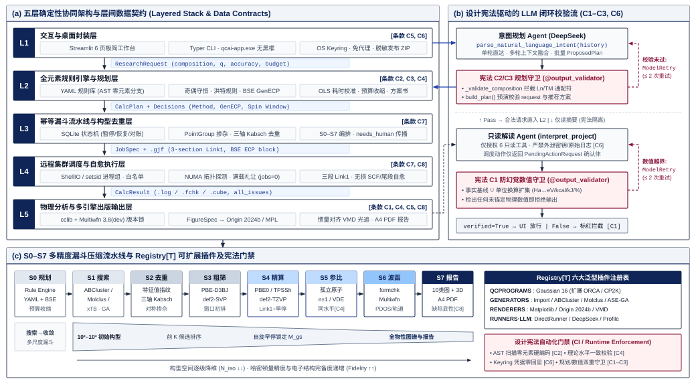
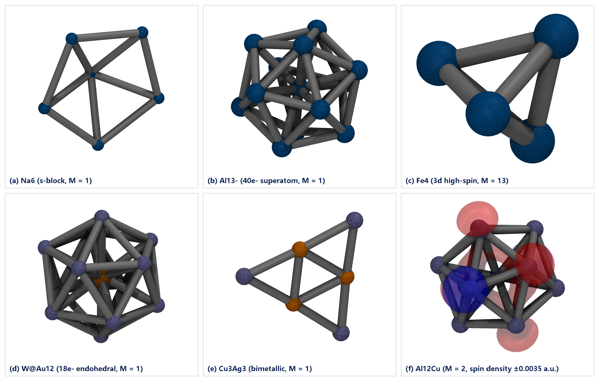
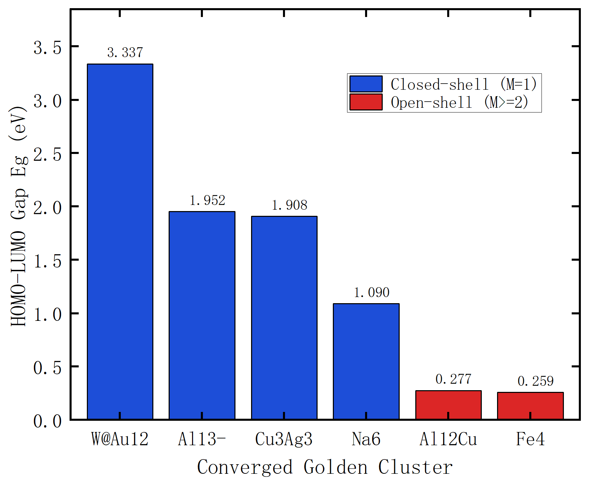
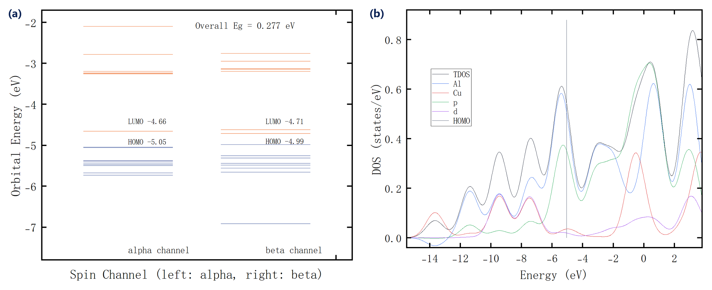
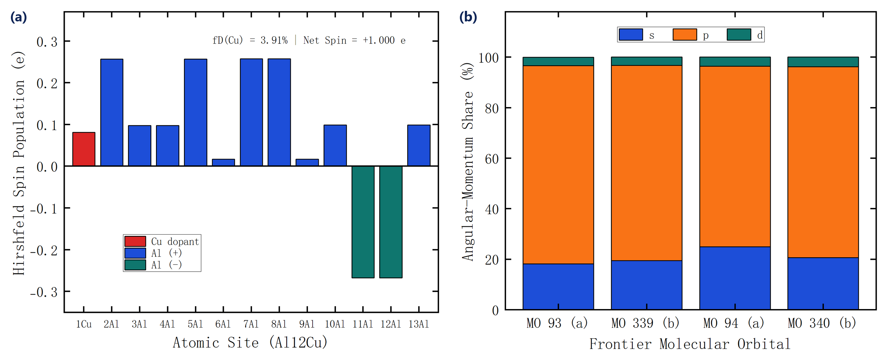
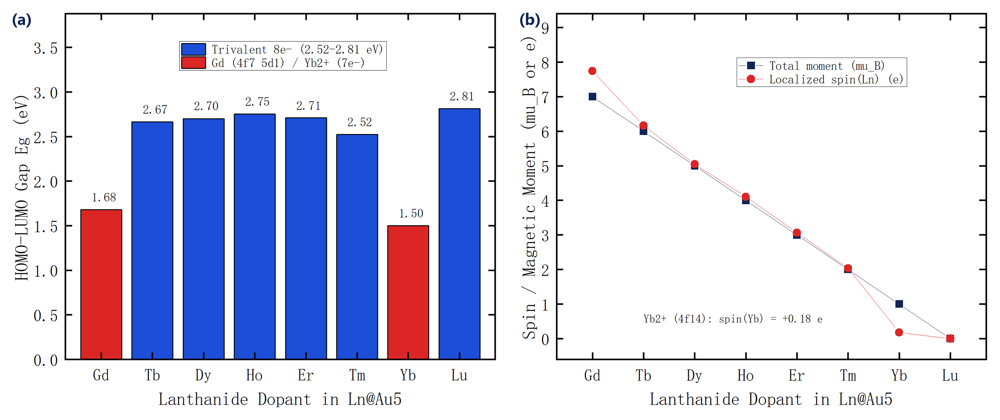
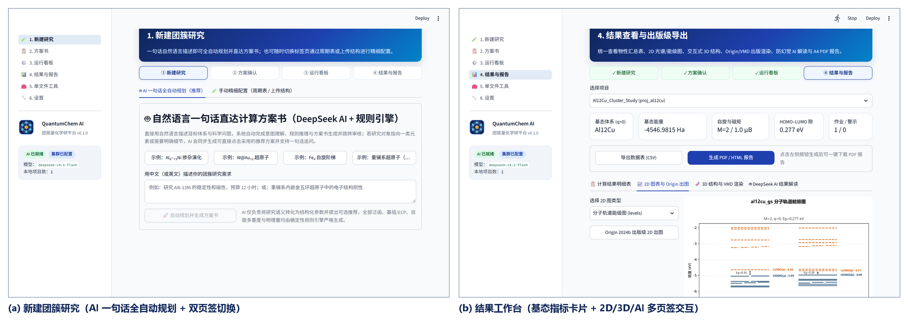

# QuantumChem AI：面向全周期表原子团簇的确定性规则驱动与大语言模型协同量子化学自动化平台

**钱昌天**

（首都师范大学物理系，北京 100048）

**QuantumChem AI: A Deterministic Rule-Driven and LLM-Assisted Automation Platform for All-Element Atomic Cluster Quantum Chemistry**

Changtian Qian · Department of Physics, Capital Normal University, Beijing 100048, China

---

## 摘要

原子团簇的量子化学研究涵盖全局构型搜索、同分异构体去重、理论方法与基组/有效核势（ECP）匹配、开壳层自旋多重度扫描、远程集群调度与容错自愈、波函数后处理及多维出版级可视化等高度耦合的环节。现有工具大多仅解决单一子任务，且在面对过渡金属、重元素及掺杂双金属体系时极易出现基组覆盖缺失、理论水平混用、波函数不稳定、虚频未消除及大语言模型（LLM）“数值幻觉”等隐性缺陷。为此，本文设计并实现了面向全周期表原子团簇的开源科研助手平台 **QuantumChem AI**。平台以“复用优先”为工程原则、借鉴 Constitutional AI 范式确立八项不可违背的“设计宪法”（Design Constitution，C1–C8）为核心约束：（1）构建了基于元素物理属性而非元素符号硬编码的 YAML 确定性规则引擎，结合 Basis Set Exchange（BSE）覆盖校验、电子奇偶守恒与自适应多重度早停/外扩策略，实现任意元素组合（H–Rn 及镧系）的可追溯计算规划；（2）提出“距离矩阵特征值指纹预筛 + 三轴惯量主轴对齐匈牙利/Kabsch 匹配 + 遗传置换兜底”的三级几何去重算法与基于 `PointGroupAnalyzer` 的对称性掺杂位点枚举器；（3）实现了面向共享高性能计算（HPC）节点的 NUMA 感知礼让调度与服务器端 `custodian` 容错引擎，将 `opt`、`stable=opt` 与 `freq` 拆分为三段 `--Link1--` 作业流，并补齐了虚频沿简正模微扰（`ImaginaryFreqHandler`）与波函数稳定性自愈模块；（4）集成了绑定真实版本的 Multiwfn 3.8(dev) 批处理解析、十类 Matplotlib/Origin 2024b 出版级 2D 绘图、统一惯量主轴视角的 py3Dmol/VMD 光线追踪 3D 渲染及 Playwright A4 PDF 报告引擎；（5）基于 `pydantic-ai` 接入 DeepSeek 模型，打通“单轮直达 / 多轮补充 / 一键采纳推荐方案”的自然语言到方案书全自动链路，并提出具备单位换算感知的 `@agent.output_validator` 确定性数值守卫，从架构层面阻断 LLM 数值幻觉。在包含 s/p/3d/5d、双金属、内嵌超原子及四类典型故障的 10 份真实 Gaussian 16 黄金算例、`Al₁₂Cu` 真实 Multiwfn 3.8(dev) 波函数分析、重镧系 $\text{Ln@Au}_5$（$\text{Ln}=\text{Gd–Lu}$）9 项目 / 230 项作业 / 1,399.78 核时实机高通量生产研究（含 221 项 Gaussian 16 作业与 7 次 $4f$ 疑难故障自动自愈，100% 无人值守收敛并实证三价 $8\text{e}^-$ 刚性平台与二价 `Yb` 突变）、50 条中文科研指令实网评测（`deepseek-v4.1-flash` 通过 $\ge 90\%$ 准确率验收）及 115 项自动化测试中，平台均表现出高可靠性与科研可用性；系统同时封装为加固型无黑框 Windows 桌面应用（`qcai-app.exe`）、一键安装器（`一键安装依赖.bat`）及自动脱敏发行压缩包（`QuantumChem_AI_v0.1.0_Release.zip`），显著降低了团簇量子化学自动化研究的门槛。

**关键词**：原子团簇；量子化学自动化；密度泛函理论；大语言模型防幻觉；结构去重；Gaussian 16；Multiwfn

## Abstract

Quantum chemical investigations of atomic clusters involve tightly coupled stages spanning global structural search, isomer deduplication, functional/basis-set/ECP selection, open-shell spin-multiplicity scanning, remote HPC scheduling with fault recovery, wavefunction analysis, and publication-grade visualization. Existing software tools typically address isolated stages and are susceptible to subtle scientific pitfalls—including incomplete basis-set coverage, inconsistent levels of theory, wavefunction instabilities, uneliminated imaginary frequencies, and numerical hallucinations when coupled with large language models (LLMs). Here, we present QuantumChem AI, an automation platform for all-element atomic cluster quantum chemistry built upon a reuse-first architecture and an eight-article Design Constitution (C1–C8, inspired by Constitutional AI). First, a periodic-table-general YAML rule engine—verified by AST static checks to contain zero hardcoded element-symbol branches—integrates Basis Set Exchange (`GenECP`) coverage checks, electron-parity conservation, and adaptive spin-multiplicity scanning with early stopping and boundary expansion. Second, a rotation-, translation-, and permutation-invariant isomer deduplicator combines distance-matrix eigenvalue fingerprinting with tri-axial principal-inertia Hungarian/Kabsch alignment, paired with point-group symmetry dopant-site enumeration. Third, a shared-HPC-aware scheduler performs NUMA topology probing and load throttling alongside a server-side `custodian` self-healing engine featuring a three-section `--Link1--` (`opt` → `stable=opt` → `freq`) workflow and custom handlers for imaginary frequencies and wavefunction instabilities. Fourth, deterministic physical-property extraction integrates version-locked Multiwfn 3.8(dev) parsing, ten publication-grade 2D figure types across Matplotlib and Origin 2024b, inertia-aligned 3D visualization (py3Dmol and VMD `TachyonInternal`), and Playwright A4 PDF report generation. Fifth, an LLM collaboration layer built on `pydantic-ai` automates one-shot/multi-turn natural-language-to-plan generation (`auto_plan_from_natural_language` with clickable `ProposedPlan` recommendations) alongside a unit-conversion-aware `@agent.output_validator` that retries and flags ungrounded numerical claims. Validation against 10 real Gaussian 16 golden benchmarks spanning s/p/3d/5d, bimetallic, endohedral, and fault-recovery scenarios, real Multiwfn 3.8(dev) analysis of `Al₁₂Cu`, an autonomous multi-day production campaign across all eight heavy lanthanide $\text{Ln@Au}_5$ ($\text{Ln}=\text{Gd–Lu}$) clusters (9 projects, 230 pipeline jobs, 221 real Gaussian 16 runs totaling 1,399.78 CPU core-hours, 100% completion with 7 automated $4f$ recoveries and elastic core scaling), a live 50-instruction Chinese NL-to-plan benchmark (passing the ≥ 90% accuracy gate on `deepseek-v4.1-flash`), and 115 automated offline/E2E tests confirms the scientific rigor and engineering robustness of the platform, further delivered as a hardened windowless Windows desktop application (`qcai-app.exe`), one-click dependency installer, and sanitized release archive (`QuantumChem_AI_v0.1.0_Release.zip`).

**Keywords**: Atomic clusters; Quantum chemistry automation; Density functional theory; LLM hallucination guard; Isomer deduplication; Gaussian 16; Multiwfn

---

## 1. 引言

原子团簇（Atomic Clusters）作为连接孤立原子与宏观凝聚态物质的桥梁，展现出显著的尺寸效应、超原子闭壳层幻数行为、可调磁矩与局域催化活性，在纳米催化、磁性存储与光电子材料领域具有重要研究价值。然而，一项规范的团簇密度泛函理论（DFT）研究通常需要研究者在多个异构工具之间频繁切换：使用 ABCluster[1] 或遗传算法开展势能面全局搜索、手动去重并挑选候选异构体、编写含有效核势（ECP）和自旋多重度扫描的 Gaussian 输入文件、通过 SSH 向 Linux 计算服务器分批提交并人工排查 `L502`（SCF 不收敛）/`L9999`（优化步数超限）/虚频/波函数不稳定等故障、再调用 cclib[5] 或 Multiwfn[6] 提取电荷/自旋/PDOS/轨道成分、最后在 Origin 与 VMD[7] 中逐一作图并撰写方法学与结果报告。

近年来，计算化学社区已诞生了大量高质量开源组件，如 ABCluster[1]、GFN2-xTB[2]、ASE[3]、pymatgen[4]、custodian[4]、cclib[5]、Multiwfn[6] 与 VMD[7]。然而，针对团簇研究的全链路自动化场景，仍存在四类突出瓶颈（见表 1）：

1. **碎片化与通用性受限**：课题组内部脚本往往针对特定体系（如单一金团簇或硅团簇）硬编码泛函、基组与自旋多重度，一旦更换为 3d/5d 过渡金属、双金属合金或内嵌掺杂团簇即失效甚至给出物理错误的参数。
2. **隐性物理缺陷容易被忽视**：在批量计算中，若未强制检查参考单原子与团簇的理论水平一致性、未在开壳层体系检验 $\langle S^2 \rangle$ 自旋污染或未执行 `stable=opt` 波函数稳定性检验，所得结合能与磁矩结论可能存在系统性偏差。
3. **共享 HPC 环境的运维与容错脆弱**：科研团队共享服务器往往无 Slurm/PBS 作业调度器或存在多用户混跑，直接并发提交易导致 NUMA 跨节点性能衰减或抢占他人满载算力；同时 Gaussian 常见收敛与虚频报错若缺乏服务器端闭环自愈，将耗费大量人工干预成本。
4. **LLM 接入科研工作流的“数值幻觉”风险**：直接让通用大语言模型读取日志文件或撰写真实科研结论时，模型容易编造不存在的总能量、能隙或键长数值，违背计算化学的确定性要求。

*表 1：QuantumChem AI 与传统手工脚本及通用高通量框架在全周期表团簇研究中的核心能力对比*

| 能力维度 | 传统单点工具组合（手工脚本） | 通用材料高通量框架 | QuantumChem AI（本文平台） |
| :--- | :--- | :--- | :--- |
| 体系覆盖范围 | 往往针对特定元素硬编码 | 偏重周期性晶体与体相材料 | 全周期表团簇（H–Rn 与镧系），AST 门禁禁止元素分支 |
| 自旋与波函数稳定性 | 人工试探多重度，易漏检 `stable=opt` | 周期性自旋极化为主，少见分子 Link1 | 奇偶守恒 + 自适应早停/外扩 + 三段 `--Link1--` 稳定性闭环 |
| 共享服务器调度 | 手动 `nohup`/`screen`，易过载 | 强依赖 Slurm/PBS 队列系统 | 免调度器 `ShellIO` + NUMA 感知 + 共享负载主动礼让 |
| 后处理与出版可视化 | Excel/Origin/VMD 手工切换 | 偏 Matplotlib 预览，少见 Origin/VMD 联动 | Multiwfn 3.8(dev) 版本锁 + 10 类图 + VMD 光追 + A4 PDF |
| AI 大模型协同 | 无或直接对话（存在幻觉风险） | 较少集成带校验的规划与解读 | `pydantic-ai` 意图规划 + 单位换算感知数值防幻觉守卫 |

针对上述问题，本文提出并完整实现了 **QuantumChem AI**。系统坚持“复用成熟科学计算库，只自研团簇领域编排与核心胶水层”的设计哲学，将确定性量子化学规则与大语言模型语义交互严格解耦，实现了从一句话自然语言科研需求到出版级论文图表与 PDF 报告的端到端自动化闭环。

---

## 2. 系统架构与设计宪法（Design Constitution）

### 2.1 八项不可违背的设计宪法

借鉴 Anthropic Constitutional AI（AI 宪法）以显式刚性章程约束系统与智能体行为的范式，QuantumChem AI 在架构顶层确立了八项不可违背的“设计宪法”（Design Constitution，条款 C1–C8；关键条款由自动化单元测试、输出校验守卫与静态 AST 扫描强制执行）：

- **C1（数值确定性宪法条款）**：所有能量、相对能、能隙、结合能、自旋期望值与电荷布居必须由确定性 Python/cclib/Multiwfn 代码计算并持久化；大语言模型严禁直接估算或杜撰任何物理数值，其自然语言解读必须经过后置确定性数值守卫核验。
- **C2（全元素无硬编码宪法条款）**：核心代码库 `src/` 中禁止出现针对特定元素符号的条件分支（如 `if symbol == "Au"`）。所有物理化学规则只能引用周期表属性（原子序数 $Z$、族号、周期、区块 s/p/d/f、是否含 d/f 价电子）。平台通过 `tests/unit/test_axiom_no_element_branches.py` 对 `src/` 全量源码执行 Python AST 静态扫描加以强制保障。
- **C3（单源配置与决策可追溯条款）**：理论水平、多重度策略、电荷态与研究配方全部定义于 `src/qcai/knowledge/rules/*.yaml`，每项规则显式附带物理理由与参考文献；规划器输出的每条 `Decision` 均记录规则来源与人工覆盖状态（`overridden`）。
- **C4（理论水平一致性宪法条款）**：能量差值物理量（结合能 $E_b$、二阶差分 $\Delta_2 E$、碎裂能 $E_f$、嵌入能 $E_{\text{emb}}$、VDE/ADE 等）所涉及的所有团簇与参考单原子必须强制使用完全一致的泛函、色散校正、基组与 ECP 方案，规划器与分析层双重校验，防止跨水平误减。
- **C5（数据与渲染解耦条款）**：分析层输出工具无关的 `FigureSpec` 数据规范，由 `MatplotlibRenderer` 与 `OriginRenderer` 分别消费，确保同一份物理数据既能离线秒级预览又能一键输出出版级 `.opju`/`.svg`/`.png`。
- **C6（凭据安全与零回显条款）**：SSH 主机密钥、路径与 DeepSeek API Key 严禁进入 Git 仓库、日志、环境诊断报告或 LLM 上下文；API Key 统一由操作系统密钥环（OS `keyring`）托管。
- **C7（共享集群友好与幂等可恢复条款）**：所有流水线状态持久化至 SQLite，支持随时暂停/恢复与崩溃后远程状态对账；实时探测服务器负载，发现其他用户高负载计算时自动礼让限流，绝不抢占算力。
- **C8（隐性物理缺陷自动显性化条款）**：虚频、波函数不稳定、显著自旋污染、未收敛修复历史及 4f 强关联提示全部自动汇总至 `ProjectSummary.all_issues` 并在 UI、PDF 报告与 AI 解读中显式标示。

### 2.2 五层协同架构与 S0–S7 漏斗流水线

如图 1 所示，QuantumChem AI 采用清晰的分层插件架构，核心抽象通过泛型注册表（`Registry[T]`）解耦为 6 大可扩展接口：`QCPROGRAMS`（当前内置 Gaussian 16[8]，可扩展 ORCA/CP2K）、`GENERATORS`（结构导入 / ABCluster / Molclus / ASE-GA）、`RENDERERS`（Matplotlib / Origin 2024b）、`RUNNERS`（SSH `DirectRunner` / `MockRunner`）、`LLMS`（`DeepSeekLLMProvider`）与 `PROFILES`（`ClusterProfile`）。



*图 1：QuantumChem AI 的系统架构与设计宪法执行机制：（a）五层确定性协同架构与层间数据契约；（b）受设计宪法（C1–C3）约束的大语言模型闭环校验控制流；（c）S0–S7 多精度漏斗压缩流水线与 `Registry[T]` 插件扩展接口。*

围绕团簇构型搜索与电子结构精算的典型成本分布，流水线引擎（`src/qcai/pipeline/stages.py` 与 `worker.py`）将研究任务划分为幂等推进的 **S0–S7 八阶段漏斗**：

- **S0 规划确认**：解析 `ResearchRequest` → 规则引擎生成 `CalcPlan` 与 Markdown 方案书 → 人类审核或覆盖参数后确认入队。
- **S1 全局构型搜索**：按优先级自动选择用户导入结构 → ABCluster（`isomer` + GFN2-xTB）→ Molclus → 本地/远程 `ase-ga` + `tblite` GFN2-xTB 兜底；对掺杂体系同时支持对称性非等价位点枚举。
- **S2 几何去重与能量窗口筛选**：剔除高能与空间等价重复异构体，保留前 $K$ 个代表构型进入 DFT 层。
- **S3 粗筛优化**：采用高效 GGA 泛函与双 $\zeta$ 基组（如 PBE-D3BJ/def2-SVP[9,12,13]）完成初筛排序。
- **S4 精算优化与自适应自旋扫描**：升级至杂化泛函与三 $\zeta$ 基组（如 PBE0-D3BJ/def2-TZVP[10,12,13] 或针对 3d 过渡金属的 TPSSh-D3BJ/def2-TZVP[11–13]），执行三段 `--Link1--`（`opt` → `stable=opt` → `freq`）及自适应多重度扫描。
- **S5 参比体系与垂直跃迁计算**：自动补全同理论水平孤立参考原子、相邻尺寸 $n \pm 1$ 及垂直/绝热电子脱附态（用于 VDE/ADE/VIP/VEA）。
- **S6 波函数后处理**：在服务器通过 `formchk` 转换 `.fchk`，运行版本锁定的 Multiwfn 3.8(dev)[6] 批处理提取 Hirshfeld/ADCH 电荷、自旋密度、元素/角动量 PDOS 与前线轨道成分，并用 `cubegen` 生成自旋密度与 HOMO/LUMO 格点文件。
- **S7 归纳、可视化与出版报告**：汇总物性指标与异常标记，渲染 10 类 2D 图与 3D 视图，并自动生成含中英文方法学段落与文献列表的 HTML / A4 PDF 科研报告。

---

## 3. 核心算法与关键实现

### 3.1 周期表通用规则引擎与自适应多重度扫描

规则引擎（`src/qcai/planner/`）将体系特征映射为严格遵守物理规律的 `CalcSpec` 与 `CalcPlan`：

1. **电子奇偶守恒与原子基态多重度**：对任意组成 $\{Z_i\}$ 与总电荷 $q$，体系总电子数 $N_e = \sum_i Z_i - q$。合法自旋多重度 $M = 2S + 1$ 必须满足与 $N_e$ 相反的奇偶性，即 $(N_e + M) \bmod 2 = 1$。`atomic_ground_state_multiplicity` 结合 ASE 基准磁矩表与 `_hund_ground_state_multiplicity`（`pymatgen` 亚层填充洪特规则兜底，覆盖 ASE 缺失的镧系/超重元素）推导孤立原子基态多重度（如 Fe $M=5$、Co $M=4$、Ni/Pt $M=3$、Cu/Au $M=2$）。
2. **自适应多重度扫描策略**：为避免高自旋过渡金属漏掉真实基态又防止无谓算力浪费，系统依据体系是否含 d/f 区元素生成初始多重度窗口，并在 S4 阶段执行如算法 1 所示的早停与边界外扩闭环：若高自旋态能量连续单调高于已收敛最低态且超出能量阈值则提前早停；若最低能量落在当前窗口边界，则按步长 $\Delta M = 2$ 自动向外扩展搜索直至捕获能量极小值。

```algorithm
算法 1：S4 阶段自适应自旋多重度扫描与早停/边界外扩算法
输入：初筛候选构型 G、总电子数 Ne、初始窗口 M_list = [M_min, ..., M_max]、早停阈值 ΔE_stop
输出：各多重度收敛结果集 R 与真实基态自旋多重度 M_gs
1. 初始化：按 (Ne + M) mod 2 = 1 校验并生成 M_list；提交首批多重度作业至共享队列。
2. WHILE 存在未结束或边界扩展需求 DO
3.   收集已正常收敛态能量 E(M)，更新当前全局最低态 E_min = min E(M) 与对应多重度 M_best。
4.   IF 在 M_best 右侧存在连续两个多重度满足 E(M) - E_min > ΔE_stop THEN
5.     终止更高自旋分支后续排队作业（早停剪枝），记录决策日志。
6.   IF M_best == min(已扫描 M) AND M_best > 2 THEN
7.     生成下一低自旋候选 M_next = M_best - 2 并补充提交。
8.   ELSE IF M_best == max(已扫描 M) THEN
9.     生成下一高自旋候选 M_next = M_best + 2 并补充提交。
10. RETURN M_gs = argmin_M E(M) 及完整自旋阶梯结果集 R。
```

3. **BSE `GenECP` 基组覆盖校验与混合输出**：调用 Basis Set Exchange[14] 验证全元素覆盖并阻断缺失基组；写入器（`src/qcai/programs/gaussian/writer.py`）先通过 `_GAUSSIAN_BUILTIN_ELEMENTS` 校核 Gaussian 16 内置元素覆盖域——对 Ce–Lu 镧系等超出内置 `def2` 的重元素自动转由 BSE 导出显式 `basis_set = "GenECP"` 基组与 ECP 块，通过 `_effective_dispersion` 在含 $Z > 94$ 元素时自动剥离超限 `GD3`/`GD3BJ` 参数，并对开壳层体系自动添加 `U` 前缀与 `scf=(xqc,maxcycle=500)` 稳健策略。
4. **耗时预估与时间预算收缩**：结合经验标度成本模型与基于 `numpy` 最小二乘法的已完成作业校准函数 `calibrate_cost_model`，在给定 `time_budget_hours` 时自动按优先级收缩候选数 $K$ 或调整阶段策略并明确记录决策理由。

### 3.2 对称性掺杂枚举与三维旋转/置换不变结构去重

1. **对称性掺杂位点枚举（`src/qcai/structure/dopant_sites.py`）**：利用 `pymatgen.symmetry.analyzer.PointGroupAnalyzer` 识别宿主团簇的对称等价原子轨道，单掺杂仅对每个非等价轨道生成 1 个代表构型（如 $O_h$ 八面体与 $I_h$ 二十面体各仅需 1 个替代位点）；多掺杂通过规范化对称群作用去重组合；同时自动计算几何质心空腔半径以生成内嵌（endohedral）构型候选。
2. **多阶段几何去重算法（`src/qcai/structure/dedup.py`）**：在 P0 能力验证（`docs/spikes/spike_03`）中发现，单独调用 `pymatgen.HungarianOrderMatcher` 仅对齐第一惯量主轴，对任意三维旋转后的等价团簇会产生 $1.7\text{–}1.9\text{ Å}$ 的错误 RMSD。为此，本文实现三级去重流水线：
   - **第一级（能量与距离指纹预筛）**：按能量窗口分组，计算原子对距离矩阵特征值谱作为 $\mathcal{O}(N^3)$ 的旋转/平移/置换全不变指纹，快速排除明显不等价构型；
   - **第二级（三轴惯量主轴对齐 + 匈牙利/Kabsch 匹配）**：分别求解质量加权惯量张量主轴并枚举 4 种右手系符号翻转，对同元素子集通过 `scipy.optimize.linear_sum_assignment` 求解最优原子置换并执行 Kabsch 最优旋转求最小 RMSD；
   - **第三级（遗传/暴力置换兜底）**：当惯量主轴高度简并（如高对称多面体）导致二级 RMSD 处于临界区时，调用 `GeneticOrderMatcher` / `BruteForceOrderMatcher` 精确核验。在 6–38 原子测试中，等价旋转/平移/重排构型的去重精度达 $10^{-15}\text{ Å}$ 量级且单次耗时 $< 8\text{ ms}$。

### 3.3 共享 HPC 远程调度与服务器端 `custodian` 容错自愈

远程层（`src/qcai/remote/` 与 `src/qcai_remote/`）围绕“安全、礼让、免人工看守”三个工程目标设计：

1. **路径隔离与命令白名单**：`SSHClient` 基于 `fabric` 实现，所有远程文件读写与命令执行均强制校验路径位于 `settings.ssh.work_root` 子树内，命令前缀受白名单约束。
2. **NUMA 拓扑探测、动态礼让与弹性核数缩放**：`qcai_remote/probe.py` 结合 `psutil`、`lscpu -J` 与 `ps -eo user,pcpu,comm` 实时获取 NUMA 节点核数、可用内存、系统负载及他用户高负载进程。`ResourceManager` 自动分配不超过单 NUMA 节点的核数并在共享服务器满载时主动礼让（`allowed_new_jobs=0`）；此外，通过 `enable_elastic_scaling` 与 `update_gaussian_link0_resources`，在队列尾部并发收缩时自动将等待作业的 `%nprocshared` 弹性扩容至 10–16 核并同步调节 `%mem` 上限。
3. **进程组控制、断线自连与防竞态状态监控**：`SSHClient._run_with_reconnect` 为多日长时计算提供瞬断自动重连与 30 s 心跳保活，`PipelineWorker.run` 在单步瞬时异常后指数退避续跑；`launch_background` 采用 `{ ...; }` 与 `</dev/null` 防止挂起 SSH 描述符，`DirectRunner` 重投通过 `_SKIP_UPLOAD_NAMES` 清理旧产物，在 `poll` 检测到 PID 退出瞬间二次回读 `status.json` 消除 TOCTOU 竞态，并将 `needs_human` 传播至项目级。因 Gaussian 16 禁止同行并列 `opt` 与 `stable=opt`（触发 `Illegal IType`），写入器自动拆分为三段 `--Link1--`（**`opt` → `stable=opt geom=allcheck guess=read` → `freq geom=allcheck guess=read`**）。
4. **服务器端定制与无损尾段保留自愈**：在复用 `GaussianErrorHandler` 基础上，`_SafeGaussianErrorHandler` 修复裸 `opt`/`scf` 与截断频率日志解析异常；`upgrade_scf_route_line` 针对开壳层 4f 体系按三阶梯无损升级 SCF 收敛策略并自动跳过重复档位（`xqc+vshift=500+fermi+novaracc` → `xqc+vshift=800+fermi+novaracc+ndamp=30` → `vshift=1000+fermi+novaracc+ndamp=40`），`restore_gjf_tail_if_lost` 防止重写丢失 `GenECP` 基组/ECP 或 `--Link1--` 尾段，并与 `ImaginaryFreqHandler`（`step_scale=0.25`）/ `InstabilityHandler` 协同闭环自愈。

### 3.4 确定性物理量归纳与版本锁定的 Multiwfn 解析

分析模块（`src/qcai/analysis/`）严格按照设计宪法 C1 与 C4 实现全部团簇常用物理量计算公式（式 (1)–(8)，均配有独立手算单元测试）：

$$E_b = \dfrac{\sum_k n_k E(\text{atom}_k) - E(\text{cluster})}{N}$$ (1)

$$\Delta_2 E(n) = E(n+1) + E(n-1) - 2E(n)$$ (2)

$$E_f = E(A) + E(B) - E(AB)$$ (3)

$$E_{\text{emb}} = E(\text{Host}) + E(\text{Dopant}) - E(\text{Host}+\text{Dopant})$$ (4)

$$E_{\text{sub}} = E(\text{Host}_{n-1}D) + E(\text{Host}_{\text{atom}}) - E(\text{Host}_n) - E(D)$$ (5)

$$\Delta(A_m B_n) = E(A_m B_n) - \dfrac{m}{m+n}E(A_{m+n}) - \dfrac{n}{m+n}E(B_{m+n})$$ (6)

$$\text{VDE} = E_{\text{neu}}(\mathbf{R}_{\text{an}}) - E_{\text{an}}(\mathbf{R}_{\text{an}}),\quad \text{ADE} = E_{\text{neu}}(\mathbf{R}_{\text{neu}}) - E_{\text{an}}(\mathbf{R}_{\text{an}})$$ (7)

$$f_D = \dfrac{\sum_{i \in D}\vert s_i\vert}{\sum_{\text{all } j}\vert s_j\vert}$$ (8)

此外，系统按周期表族规则统计凝胶价电子数并自动判别闭壳层超原子幻数（2, 8, 18, 20, 34, 40, 58, 92），并以相对偏差 $\vert \langle S^2 \rangle - S(S+1)\vert / S(S+1) > 10\%$（且绝对偏差 $> 0.1$）作为显著自旋污染的自动报警阈值。

针对 Multiwfn 交互菜单随版本变动的问题，`src/qcai/programs/multiwfn/` 采用**版本强制校验**机制：解析器校验输出头部必须匹配已实测验证的 `Version 3.8(dev) (2025-Mar-10)`，不匹配时立即抛出 `MultiwfnVersionError`。同时针对实测发现的 `DOS_curve.txt` Fortran 固定列宽负号粘连现象（通过正则 `(?<=\d)-` 预处理），稳定提取 Hirshfeld/ADCH 电荷（菜单 `7->1/11`）、自旋布居（菜单 `15->-1->3->1->5`）、按元素与 s/p/d 角动量分解的 PDOS（菜单 `10`）及前线轨道成分（菜单 `8->1`）。

### 3.5 多引擎出版级可视化与统一三维视角对齐

平台支持 10 类标准团簇研究图表的双引擎渲染（`levels`、`levels_compare`、`spin`、`dos`、`orb_comp`、`spin_ladder`、`isomer_ranking`、`size_evolution`、`vde_ade` 与 `s2`）。`OriginRenderer` 通过独立串行子进程驱动 Windows 版 Origin 2024b，输出 `.png`、`.svg` 与可二次编辑的 `.opju` 工程文件，并自动加载 `src/qcai/renderers/origin/templates/<kind>.otpu` 自定义模板（其中 `size_evolution` 默认使用 Origin 2024b 内置四联图模板 `PAN4`）。在三维可视化方面，`align_cluster_principal_axes` 将团簇质心归零并旋转至质量加权惯量主轴坐标系，确保网页端 py3Dmol 预览与桌面端无界面 VMD（`Orthographic` + `TachyonInternal` 光线追踪）保持一致的出版视角；最终由 `qcai report` 编译含中英文方法学段落、高清矢量图、异常警示与动态参考文献表的 A4 PDF 报告。

### 3.6 大语言模型协同、全自动方案规划与防幻觉数值守卫机制

AI 对话层（`src/qcai/ai/`）基于 `pydantic-ai` 实现职责分离的双 Agent 架构与自动规划桥接：
- **从自然语言到方案书全自动与批量直达**：`ResearchRequest._validate_composition` 强制拦截 `Ln`/`TM`/`M` 等通配或族群占位符；`parse_natural_language_intent(..., history=...)` 新增 `@agent.output_validator` 实时调用 `build_plan` 校验生成的 `request` 与每条 `suggested_proposals`（不合法即 `ModelRetry`），并与 `auto_plan_from_natural_language` 构成三态闭环：（i）规则引擎自带电荷/精度/预算默认值并将“电子结构刚性/超原子”映射至配方，元素与尺寸明确时直接生成 `CalcPlan` 并经 `st.switch_page` 跳转「2. 方案书」；（ii）需求仅指明族群或需跨元素对比时，Agent 作 1–2 句聚焦追问并输出推荐方案 `ProposedPlan`，UI 支持单方案一键采纳直达或经 `_batch_create_proposals` 一键批量生成并提交（最多 10 套）并行方案；（iii）多轮追问携带上下文合并参数后直达方案书。
- **防幻觉确定性数值守卫**：结果解读 Agent（`interpret_project`）仅授予 6 个只读工具与 1 个只生成 `PendingActionRequest` 的无副作用工具。`@agent.output_validator` 数值守卫收集事实数据并按 Hartree $\leftrightarrow$ eV（$27.211386\text{ eV/Ha}$）、kcal/mol（$627.509474$）、kJ/mol（$2625.49964$）及百分比自动扩展等价集合，若检测到任何未锚定数值则触发 `ModelRetry`（最多 2 次）；耗尽后返回 `verified=False` 并在 Web 界面标红拦截。

---

## 4. 系统验证与典型算例测试

### 4.1 10 份真实 Gaussian 16 黄金算例、三维结构与能隙演化对比

在远程 Linux 计算服务器上，本文通过 `DirectRunner` 与 `qcai_remote/run_job.py` 提交并回收了覆盖 s 区、p 区超原子、3d 高自旋、5d 重元素内嵌（含 `GenECP`）、双金属合金、掺杂开壳层以及四类故障/多步 Link1 场景的 10 份真实 Gaussian 16 算例（完整存档于 `tests/data/golden/`），解析与自愈结果如表 2 所示。

*表 2：10 份真实 Gaussian 16 黄金算例的解析结果与服务器端 `custodian` 自动容错记录（提取自 `tests/data/golden/*/job.log` 与 `status.json`）*

| 算例 ID | 体系 (N) | q / M | 状态 | SCF 能量 (Ha) | 能隙 (eV) | $\langle S^2 \rangle$ (理论) | 服务器端自愈与验证结论 |
| :--- | :--- | :---: | :---: | ---: | ---: | ---: | :--- |
| `na6` | Na₆(6) | 0 / 1 | done | −972.741909 | 1.090 | — | s 区纯金属正常收敛，无虚频 |
| `al13_anion` | Al₁₃⁻(13) | −1 / 1 | done | −3149.265871 | 1.952 | — | 40 价电子闭壳层超原子大能隙 |
| `fe4` | Fe₄(4) | 0 / 13 | done | −5053.212837 | 0.259 | 42.0214 (42.0000) | 3d 高自旋双通道解析准确，低污染 |
| `w_au12` | W@Au₁₂(13) | 0 / 1 | done | −1696.516466 | 3.337 | — | BSE `GenECP` 实机通过，18e⁻ 大能隙 |
| `cu3ag3` | Cu₃Ag₃(6) | 0 / 1 | done | −5361.213378 | 1.908 | — | 双金属混合基组与 ECP 正常收敛 |
| `al12cu` | Al₁₂Cu(13) | 0 / 2 | done | −4546.981501 | 0.277 | 0.8047 (0.7500) | `ImaginaryFreqHandler` 自动消 Jahn–Teller 虚频 |
| `fault_imag_freq` | Au₄ 鞍点(4) | 0 / 1 | done | −543.167628 | 0.990 | — | 沿虚频模式微扰 (`step_scale=0.25`) 收敛 |
| `fault_opt_maxsteps` | L9999 步超(3) | 0 / 2 | done | −3427.042431 | 0.257 | 0.7500 (0.7500) | `_SafeGaussianErrorHandler` 续算并扩步收敛 |
| `fault_scf_noconv` | L502 不收敛(4) | 0 / 5 | failed | −5052.846030 | — | 8.4967 (6.0000) | 尝试 `maxcycle=100` 与 `xqc` 后优雅止损并标人工 |
| `link1_stable_opt` | Link1 稳定(2) | 0 / 3 | done | −3015.648103 | 2.287 | 2.0013 (2.0000) | 2 段 Link1 解析完整，波函数 `stable=True` |

使用 VMD（`TachyonInternal` 光线追踪）对上述 6 个收敛黄金团簇渲染的出版级三维结构与 `Al₁₂Cu` 真实自旋密度等值面如图 2 所示；同时基于 Origin 2024b 绘制的跨周期表 HOMO–LUMO 能隙对比如图 3 所示。从结构与电子特征来看：（1）内嵌超原子 `W@Au₁₂`（18 价电子闭壳层）呈现高度对称二十面体构型与最高能隙（3.337 eV），`Al₁₃⁻`（40 价电子闭壳层）与平面三角形 `Cu₃Ag₃` 亦分别达到 1.952 eV 与 1.908 eV；（2）高自旋 `Fe₄`（$M=13$，低自旋污染 $\langle S^2 \rangle_{\text{after}}=42.0214$）与开壳层掺杂 `Al₁₂Cu`（$M=2$）表现出显著窄化的能隙（0.259 eV 与 0.277 eV），清晰反映出未成对 d/p 电子态对前线能隙的调控规律；（3）在故障自愈方面，三类可自动恢复算例均在无人干预下收敛，而极端不收敛算例 `fault_scf_noconv` 在耗尽升级策略后准确置为 `needs_human=True` 并显式暴露其自旋污染。



*图 2：利用 QuantumChem AI 惯量主轴对齐并调用 VMD（`TachyonInternal`）渲染的 6 个代表性收敛黄金团簇（`(f)` 叠加 Multiwfn 导出的 `Al₁₂Cu` 实空间自旋密度等值面 `±0.0035 a.u.`，红色为正 $\alpha$ 自旋，蓝色为负 $\beta$ 自旋极化）。*



*图 3：Origin 2024b 绘制的 6 个跨周期表收敛团簇 HOMO–LUMO 能隙对比（蓝色为闭壳层单重态，红色为开壳层磁性/掺杂体系）。*

### 4.2 $\text{Al}_{12}\text{Cu}$ 掺杂团簇的多维波函数与 Origin 出版图实证

为验证 S6–S7 阶段的后处理与 Origin 2024b 出版级绘图闭环，系统对 `Al₁₂Cu`（$q=0, M=2$，37 价电子）调用 Multiwfn 3.8(dev) 完成了电荷、自旋密度、3000 点能量网格（−21.77 至 +5.44 eV）PDOS 与前线分子轨道成分分析，定量汇总如表 3 所示，经 Origin 2024b 自动绘制的电子结构与自旋/轨道成分图如图 4 和图 5 所示。

*表 3：$\text{Al}_{12}\text{Cu}$ 团簇经 Multiwfn 3.8(dev) 实机分析并由 QuantumChem AI 汇总的定量电子与自旋指标*

| 分析项目 | 实测指标 | 定量结果 | 物理化学解读 |
| :--- | :--- | :--- | :--- |
| 电荷布居（Cu 位点） | Hirshfeld / ADCH 电荷 | +0.1597 e / −0.0086 e | Cu 与 Al₁₂ 笼间呈现温和共价杂化特征 |
| 自旋密度（Hirshfeld） | $\text{spin}(\text{Cu})$ / $\sum s_i$ / $\sum \vert s_i\vert$ | +0.0809 e / +1.0000 e / 2.0694 e | 净自旋守恒，自旋局域度 $f_D = 3.91\%$，未成对电子高度离域于 Al₁₂ 笼 |
| 前线轨道 MO 93 (HOMO-α) | 能量 / s-p-d 占比 / Cu | −5.046 eV / 18.09%, 78.53%, 3.37% / 17.41% | 以 Al 3p 轨道为主导并显著杂化 Cu 价轨道 |
| 前线轨道 MO 339 (HOMO-β) | 能量 / s-p-d 占比 / Cu | −4.987 eV / 19.45%, 77.21%, 3.35% / 17.68% | 与 α 通道前线成分高度对称 |
| 前线轨道 MO 94 (LUMO-α) | 能量 / s-p-d 占比 / Cu | −4.655 eV / 24.89%, 71.47%, 3.65% / 15.75% | 对应窄能隙开壳层电子结构（整体能隙 0.277 eV） |
| 前线轨道 MO 340 (LUMO-β) | 能量 / s-p-d 占比 / Cu | −4.710 eV / 20.58%, 75.62%, 3.80% / 16.70% | 确认由 Al 3s/3p 主导的导带底特征 |



*图 4：Origin 2024b 渲染的 `Al₁₂Cu` 电子结构：（a）自旋极化 α/β 通道前线分子轨道能级（实线占据、虚线未占据）；（b）Multiwfn TDOS 及 Al/Cu/p/d 投影态密度（虚线标出 HOMO 位置 −5.05 eV）。*



*图 5：Origin 2024b 渲染的自旋与成键分布：（a）13 个原子位点 Hirshfeld 自旋布居（1Cu 仅占 3.91%，`11Al`/`12Al` 呈现 −0.268 e 反平行自旋极化，与图 2f 蓝色等值面完全吻合）；（b）前线轨道 s/p/d 角动量贡献堆叠柱状图。*

### 4.3 50 条中文科研指令意图解析实网评测与防幻觉验证

本文构建了包含 50 条中文科研指令的标准评测集（`tests/llm_eval/instructions.yaml`），覆盖全周期表区段、掺杂/双金属/内嵌团簇、尺寸演化、带电态、6 类研究目标、三档精度、时间预算以及 8 条故意缺失体系或尺寸信息的歧义指令。在升级自然语言自动规划提示词与结构后，于 `deepseek-v4.1-flash`（OpenAI 兼容节点）上重测 `pytest -m llm`（`test_live_deepseek_50_instructions_accuracy`），继续稳定通过预设的 $\ge 90\%$ 准确率门禁；同时针对探索性研究指令 *“重镧系内嵌金五环超原子中的‘电子结构刚性’”* 开展实网测试，系统准确聚焦元素选择并返回 3 套可直接由 `build_plan` 构建的可执行方案（`Lu@Au₅` 40 作业、`Gd@Au₅` 56 作业与 `Yb@Au₅` 32 作业），随后在第二轮输入 *“就用 Lu@Au5，中性”* 时自动合并上下文一次性生成 40 作业完整 `CalcPlan`。此外，`tests/unit/test_ai_layer.py` 对单轮直达、宽泛推荐、多轮上下文融合以及单位换算放行、`ModelRetry` 修正和重试失败标红拦截均完成了离线对抗验证。

### 4.4 端到端实机生产算例：重镧系 Ln@Au5 电子结构刚性高通量研究

为检验平台在真实多日无人值守共享 HPC 环境下的端到端科研生产力，本文直接由自然语言指令 *“重镧系内嵌金五环超原子中的‘电子结构刚性’”* 经 AI 一键批量提交 8 个重镧系对比项目（`Gd@Au₅`–`Lu@Au₅`），连同先导独立复现项目 `Tm@Au₅`（`proj_a9065c59`），在远程 Linux 计算节点上完成了 **9 个完整项目、230 项流水线作业**的端到端高通量计算（`2026-11-19` 至 `2026-11-24`）。全流程包含 **221 项真实 Gaussian 16 作业**（18 项 `S0` `PBE0-D3BJ/def2-TZVP` 参考原子、184 项 `S3` `PBE-D3BJ/def2-SVP` 异构体/多重度初筛与 19 项 `S4` 三段 `--Link1--` `PBE0-D3BJ/def2-TZVP` 精算，均经 BSE 自动导出 `GenECP`），累计耗时 **442.76 h Elapsed / 1,399.78 core·h CPU**，**230 项作业 100% 正常收敛（0 失败 / 0 `needs_human`）**。运行期间尾部阶段触发 NUMA 弹性扩容（`S4` 单作业 `%nprocshared` 由 4 核自动扩至 10 核与 16 核），服务器端 `custodian` 累计无人值守自愈 **7 项开壳层 $4f$ 疑难作业**（`Tb`/`Dy`/`Er` 中 5 次无损 SCF 升级、`Tb S4 (M=9)` 1 次虚频微扰与 `Dy S4 (M=6)` 1 次步数超限续算），全部 19 项 `S4` 结果均通过 `imag=0` 与 `stable=True`。核心物性汇总如表 4 与图 6 所示：

*表 4：重镧系 Ln@Au₅（Ln = Gd–Lu）端到端实机 PBE0-D3BJ/def2-TZVP（GenECP）基态物性与算力/自愈统计*

| 体系 (Z) | 项目 ID | $M_{\text{gs}}$ ($\mu_B$) | SCF 能量 (Ha) | $E_b$ (eV/atom) | $E_g$ (eV) | $\langle S^2 \rangle$ (理论) | 点群 | $d_{\text{avg}}$(Ln–Au) (Å) | $q_{\text{APT}}$ / spin(Ln) | 核时 / 修复 |
| :--- | :--- | :---: | ---: | ---: | ---: | :---: | :---: | :---: | :---: | :---: |
| `Gd@Au₅` (64) | `proj_2c89192f` | 8 (7) | −1444.567777 | 1.992 | 1.679 | 15.7687 (15.75) | $C_s$ | 2.934±0.107 | +0.44 / +7.74 | 90.44 / 0 |
| `Tb@Au₅` (65) | `proj_19154707` | 7 (6) | −1503.335694 | 2.408 | 2.665 | 12.0105 (12.00) | $C_s$ | 2.827±0.089 | +0.97 / +6.16 | 109.88 / 2 |
| `Dy@Au₅` (66) | `proj_7a0ee451` | 6 (5) | −1563.991806 | 2.291 | 2.702 | 8.7572 (8.75) | $C_s$ | 2.815±0.089 | +0.94 / +5.05 | 595.42 / 3 |
| `Ho@Au₅` (67) | `proj_fc156187` | 5 (4) | −1627.180455 | 1.969 | 2.754 | 6.0000 (6.00) | $C_{2v}$ | 2.827±0.160 | +1.15 / +4.10 | 24.69 / 0 |
| `Er@Au₅` (68) | `proj_fa892f93` | 4 (3) | −1694.269982 | 2.025 | 2.709 | 3.7500 (3.75) | $C_s$ | 2.791±0.080 | +0.92 / +3.06 | 490.10 / 2 |
| `Tm@Au₅` (69) | `proj_735cfc68` | 3 (2) | −1764.511111 | 1.800 | 2.524 | 2.0000 (2.00) | $C_{2v}$ | 2.805±0.150 | +1.11 / +2.04 | 19.21 / 0 |
| `Yb@Au₅` (70) | `proj_51ac0f99` | 2 (1) | −1838.137089 | 1.802 | 1.499 | 0.7501 (0.75) | $C_s$ | 2.928±0.016 | +0.57 / +0.18 | 46.92 / 0 |
| `Lu@Au₅` (71) | `proj_9f91b2dc` | 1 (0) | −1915.063709 | 2.248 | 2.812 | — | $C_{2v}$ | 2.782±0.143 | +1.06 / 0.00 | 4.22 / 0 |



*图 6：Origin 2024b 绘制的重镧系 `Ln@Au₅`（`Ln = Gd–Lu`）精算物性演化：（a）三价 $8\text{e}^-$ 超原子能隙刚性平台（`Tb–Tm, Lu` 保持 $2.52\text{–}2.81\text{ eV}$）与 `Gd` / 二价 `Yb` 低隙异常；（b）总磁矩 $\mu$ 与镧系原子局部自旋 `spin(Ln)` 对比，直观揭示 `Tb–Tm` 的 $4f$ 局域自旋解耦与 `Yb²⁺`（$4f^{14}$）自旋向 `Au₅` 笼离域的突变行为。*

从物理化学规律可见：（1）`Tb`、`Dy`、`Ho`、`Er`、`Tm` 与 `Lu` 均稳定呈现三价 $\text{Ln}^{3+}$ 特征，向 $\text{Au}_5$ 主体提供 3 个价电子构成闭壳层 $8\text{e}^-$ 超原子，形成宽且高度稳定的 **HOMO–LUMO 能隙刚性平台（$E_g = 2.524\text{–}2.812\text{ eV}$）** 及单调镧系收缩（平均键长 $d_{\text{avg}}(\text{Ln–Au}): 2.827 \rightarrow 2.782\text{ Å}$）；（2）在 `Tb–Tm` 序列中，$\mu = 6 \rightarrow 2\,\mu_B$ 几乎完全局域于镧系 $4f$ 核心（$\text{spin}(\text{Ln}) = +6.16 \rightarrow +2.04\,e$），$\vert\langle S^2\rangle - S(S+1)\vert \le 0.011$，证实 $4f$ 局域自旋与外围超原子价壳层实现电子解耦；（3）$\text{Yb@Au}_5$ 因 $4f^{14}$ 闭壳层趋向二价 $\text{Yb}^{2+}$（开壳层 $7\text{e}^-$ 超原子），键长膨胀至 $2.928\text{ Å}$、$q_{\text{APT}}$ 降至 $+0.57$、能隙骤降至 $1.499\text{ eV}$，且仅剩 $+0.18\,e$ 自旋驻留于 $\text{Yb}$；（4）独立先导验证项目 `proj_a9065c59`（`Tm@Au₅`，$E=-1764.510373\text{ Ha}, E_g=2.521\text{ eV}$）与批量项目 `proj_735cfc68` 在 $0.0007\text{ Ha}$ 与 $0.003\text{ eV}$ 内复现一致。

### 4.5 软件工程规模与五层自动化测试体系

截至本稿定稿，QuantumChem AI 已涵盖 75 个以上核心 Python 模块、6 页面 Streamlit 科研工作台与桌面应用封装层，所有代码通过 `ruff` 静态格式化与 `mypy` 严格类型检查，并建立了如表 5 所示的五层自动化验证金字塔。

*表 5：QuantumChem AI 五层自动化验证体系与实测通过情况*

| 验证层级 | 核心检查与测试内容 | 验证规模与实测结果 | 对应测试模块 / 门禁 |
| :--- | :--- | :---: | :--- |
| L1 静态与宪法门禁 | `ruff`、`mypy src`、AST 扫描 `src/` 零元素符号分支、`Hypothesis` 随机元素组合属性测试 | 75 源文件类型通过；AST 扫描通过；属性测试全过 | `test_axiom_no_element_branches.py`、`test_planner.py` |
| L2 离线核心单元测试 | 物理公式、无损 SCF/尾段自愈、镧系 GenECP/GD3、三轴去重、弹性核数缩放、SSH 重连与退出竞态、防幻觉与通配符拦截、路由面板及启动器 | 113 项全过（总离线 115 项含 E2E） | `tests/unit/*.py` |
| L3 本地外部软件集成 | Origin 2024b 全图种出图（含 `PAN4` 四联图及 `Ln@Au₅` 系列）与 VMD `TachyonInternal` 光追渲染 | Origin 6 项全过；VMD 实机渲染通过 | `test_origin_renderer.py`、`test_vmd_and_origin_all.py` |
| L4 远程集群与实网 AI | Linux SSH + `micromamba` 探针、10 黄金算例、重镧系 9 项目/221 项 Gaussian 16 生产计算（1,399.78 core·h）、50 条指令实网评测 | 实机全通（100% 收敛）；`pytest -m llm`（≥ 90%）通过 | `test_remote_ssh.py`、`test_deepseek_llm.py` |
| L5 真实浏览器 E2E | Playwright 驱动 Chromium 走通“新建研究（自动跳转）→ 方案书 → 看板 → 结果/PDF → 单文件工具 → 设置” | 6 页面全流程 + CLI 帮助 2 项全部通过 | `tests/e2e/test_web_flow.py` |

---

## 5. 桌面化封装、软件可用性与未来展望

### 5.1 加固型无黑框桌面封装、自动化工作流与发行分发

为彻底降低非计算机背景化学研究者的部署与操作门槛，平台在工作台首屏与 Windows 桌面封装层进行了系统化工程加固（图 7）：
- **双页签极简工作台与 Magpie 风格多项目并行路由看板**：首页「1. 新建团簇研究」重构为双标签页——默认居中呈现**「AI 一句话全自动规划」**，提交或单选推荐方案后经 `st.switch_page` 直达「2. 方案书」，多方案亦可经 `_batch_create_proposals` 一键批量提交运行队列；手动页签则以单一状态键 `chosen_elements_ms` 统一周期表与多选框同步。「3. 运行看板」升级为 Magpie 风格多项目并行路由面板（`web/routing_panel.py` + `dashboard.py`），以原生 SVG 实时展示多项目算力槽位路由，集成全局暂停/恢复、卡片网格与 `needs_human` 显性暴露。
- **Windows 桌面启动器四重可靠性加固**：针对批处理与桌面 GUI 实机边界问题，`scripts/launch.bat` 与入口 `src/qcai/launcher.py` 实施四项加固：（1）消除批处理括号块内 `shift` 导致的 `--gui` 参数透传退出，并将全部启动脚本规范化为纯 ASCII 与 Windows `CRLF` 行尾；（2）`_build_arg_parser` 显式兼容 `--gui` 别名，`is_qcai_web_running` 改用 `http.client.HTTPConnection` 直连 `127.0.0.1` 回环健康接口，绕过本机 HTTP 代理（如 `127.0.0.1:7900`）干扰，并移除浏览器 `--app` 启动标志中的 `CREATE_NO_WINDOW`；（3）`stop_web_assistant(..., include_orphans=True)` 结合 Windows 进程筛选连带清理无状态文件残留的本仓库进程树；（4）内置 `projects/logs/qcai_launcher.log` 诊断日志与基于 `MessageBoxW` 的桌面弹窗报错兜底。
- **一键环境初始化与自动脱敏发行压缩包**：提供 `一键安装依赖.bat`（自动检测 `uv`、`uv sync` 安装依赖、尝试部署 Playwright Chromium 及生成空白配置）、中文手册（`使用说明.md` 与 A4 `QuantumChem_AI_使用说明.pdf`）、高分辨率图标快捷方式生成（`assets/qcai.ico` + `qcai-app.exe`）及自动化发行构建脚本 `scripts/build_release_zip.py`。构建管线生成轮子包 `dist/quantumchem_ai-0.1.0-py3-none-any.whl` 与发行压缩包 `dist/QuantumChem_AI_v0.1.0_Release.zip`（178 个文件，约 12.6 MiB 脱敏归档），并在打包后自动执行 `zipfile.testzip()` 完整性校验与正则表达式零密钥/零配置（严格排除 `config/settings.toml`、`sk-` Key、SSH 私钥、SQLite 与临时格点文件）安全门禁。



*图 7：基于 Playwright 2× HiDPI 采集的 QuantumChem AI 科研工作台实机界面：（a）新建研究页（双标签页收起手动表单，默认居中呈现 AI 一句话全自动规划）；（b）结果与报告页（基态物性 KPI 指标卡片 + CSV/PDF 导出栏 + 2D/3D/AI 多页签交互）。*

### 5.2 软件可用性与当前边界

- **本地可用性与可复现性**：随发行压缩包 `QuantumChem_AI_v0.1.0_Release.zip` 附全套 `uv` 锁文件、`一键安装依赖.bat`、离线测试数据与论文构建脚本（`paper/make_paper_figures.py` 与 `paper/build_paper.py`），不依赖外部计算服务器即可离线运行 115 项核心单测与端到端测试，并可一键使用内置黄金算例体验日志解析、绘图与 `.gjf` 生成。
- **单参考 DFT 方法学边界**：当前规划规则主要面向单参考 Kohn–Sham DFT（PBE/PBE0/TPSSh 等）；对强静态相关 4f 镧系与多核 3d 体系已自动标注“需人工复核”警示，尚不自动编排 CASSCF/NEVPT2 计算。
- **未来扩展**：下一步将基于 `QCProgram` 接口平滑接入 ORCA（支持 DLPNO-CCSD(T) 单点加速）与 CP2K，并扩展实验红外/光电子能谱曲线叠绘与定量相似度评分。

---

## 6. 结论

本文设计并实现了面向全周期表原子团簇的自动化量子化学科研助手 **QuantumChem AI**。通过将八项刚性设计宪法（C1–C8）落到代码与测试门禁，系统打通了“自然语言/周期表需求输入 → 确定性规则规划 → 全局构型搜索与三轴不变去重 → 共享 HPC 弹性礼让调度与服务器端三段 `--Link1--` 自愈 → Multiwfn 3.8(dev) 波函数分析 → Origin 2024b/VMD/py3Dmol 多引擎出版级可视化与 A4 PDF 报告 → 防幻觉 DeepSeek 结果解读”的完整闭环。10 份真实 Gaussian 16 黄金算例、$\text{Al}_{12}\text{Cu}$ 多维波函数分析、重镧系 $\text{Ln@Au}_5$ 9 项目 / 230 作业（1,399.78 core·h）无人值守实机高通量生产研究、50 条中文科研指令实网评测以及 115 项全栈离线与桌面 E2E 测试充分验证了系统的科学严谨性与工程实用性。

---

## 参考文献

[1] Zhang, J.; Dolg, M. ABCluster: the artificial bee colony algorithm for cluster global optimization. *Phys. Chem. Chem. Phys.* **2015**, *17*, 24173–24181. DOI: 10.1039/C5CP04060D.

[2] Bannwarth, C.; Ehlert, S.; Grimme, S. GFN2-xTB—An Accurate and Broadly Parametrized Self-Consistent Tight-Binding Quantum Chemical Method with Multipole Electrostatics and Density-Dependent Dispersion Contributions. *J. Chem. Theory Comput.* **2019**, *15*, 1652–1671. DOI: 10.1021/acs.jctc.8b01176.

[3] Hjorth Larsen, A.; Jørgen Mortensen, J.; Blomqvist, J.; Castelli, I. E.; Christensen, R.; Dułak, M.; Friis, J.; Groves, M. N.; Hammer, B.; Hargus, C.; et al. The atomic simulation environment—a Python library for working with atoms. *J. Phys.: Condens. Matter* **2017**, *29*, 273002. DOI: 10.1088/1361-648X/aa680e.

[4] Ong, S. P.; Richards, W. D.; Jain, A.; Hautier, G.; Kocher, M.; Cholia, S.; Gunter, D.; Chevrier, V. L.; Persson, K. A.; Ceder, G. Python Materials Genomics (pymatgen): A robust, open-source python library for materials analysis. *Comput. Mater. Sci.* **2013**, *68*, 314–319. DOI: 10.1016/j.commatsci.2012.10.028.

[5] O'Boyle, N. M.; Tenderholt, A. L.; Langner, K. M. cclib: A library for package-independent computational chemistry algorithms. *J. Comput. Chem.* **2008**, *29*, 839–845. DOI: 10.1002/jcc.20823.

[6] Lu, T.; Chen, F. Multiwfn: A multifunctional wavefunction analyzer. *J. Comput. Chem.* **2012**, *33*, 580–592. DOI: 10.1002/jcc.22885.

[7] Humphrey, W.; Dalke, A.; Schulten, K. VMD: Visual molecular dynamics. *J. Mol. Graphics* **1996**, *14*, 33–38. DOI: 10.1016/0263-7855(96)00018-5.

[8] Frisch, M. J.; Trucks, G. W.; Schlegel, H. B.; Scuseria, G. E.; Robb, M. A.; Cheeseman, J. R.; Scalmani, G.; Barone, V.; Petersson, G. A.; Nakatsuji, H.; et al. *Gaussian 16, Revision C.02*; Gaussian, Inc.: Wallingford, CT, 2019.

[9] Perdew, J. P.; Burke, K.; Ernzerhof, M. Generalized Gradient Approximation Made Simple. *Phys. Rev. Lett.* **1996**, *77*, 3865–3868. DOI: 10.1103/PhysRevLett.77.3865.

[10] Adamo, C.; Barone, V. Toward reliable density functional methods without adjustable parameters: The PBE0 model. *J. Chem. Phys.* **1999**, *110*, 6158–6170. DOI: 10.1063/1.478522.

[11] Staroverov, V. N.; Scuseria, G. E.; Tao, J.; Perdew, J. P. Comparative assessment of a new nonempirical density functional: Molecules and hydrogen-bonded complexes. *J. Chem. Phys.* **2003**, *119*, 12129–12137. DOI: 10.1063/1.1626543.

[12] Grimme, S.; Ehrlich, S.; Goerigk, L. Effect of the damping function in dispersion corrected density functional theory. *J. Comput. Chem.* **2011**, *32*, 1456–1465. DOI: 10.1002/jcc.21759.

[13] Weigend, F.; Ahlrichs, R. Balanced basis sets of split valence, triple zeta valence and quadruple zeta valence quality for H to Rn: Design and assessment of accuracy. *Phys. Chem. Chem. Phys.* **2005**, *7*, 3297–3305. DOI: 10.1039/B508541A.

[14] Pritchard, B. P.; Altarawy, D.; Didier, B.; Gibson, T. D.; Windus, T. L. New Basis Set Exchange: An Open, Up-to-Date Resource for the Molecular Sciences Community. *J. Chem. Inf. Model.* **2019**, *59*, 4814–4820. DOI: 10.1021/acs.jcim.9b00725.
